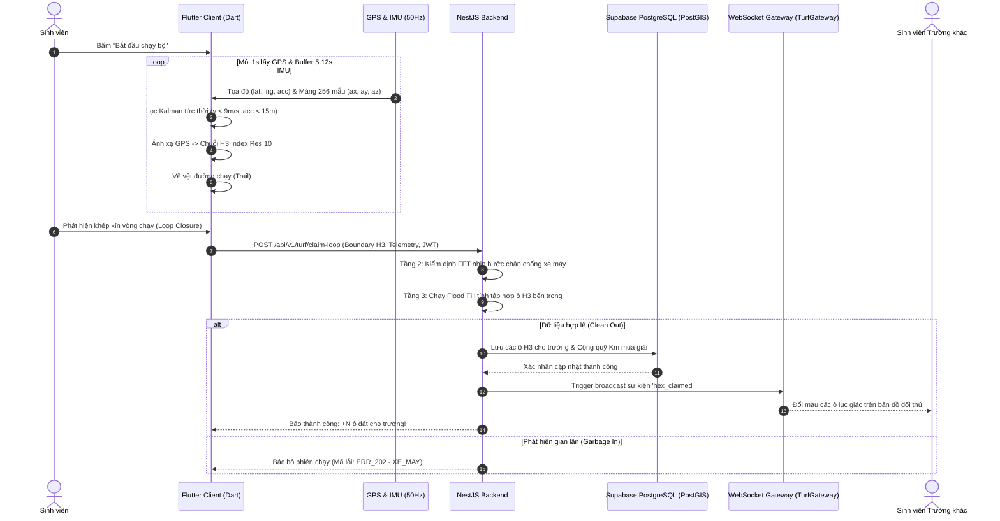
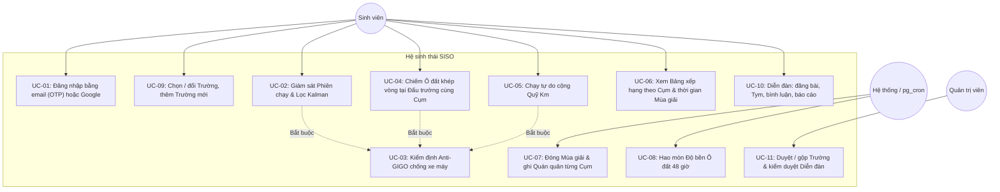
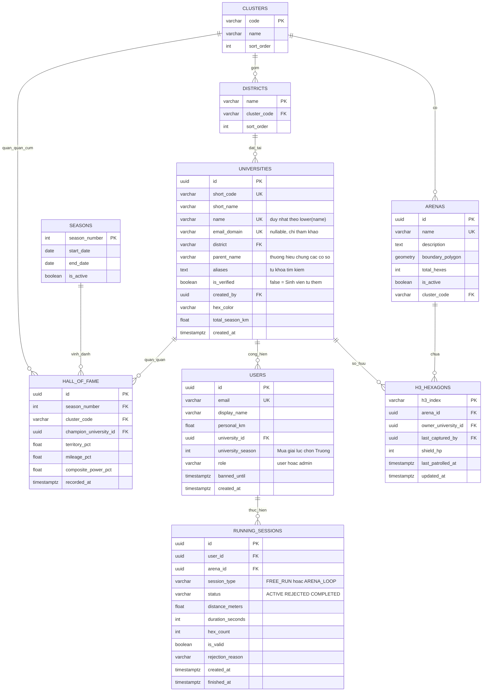
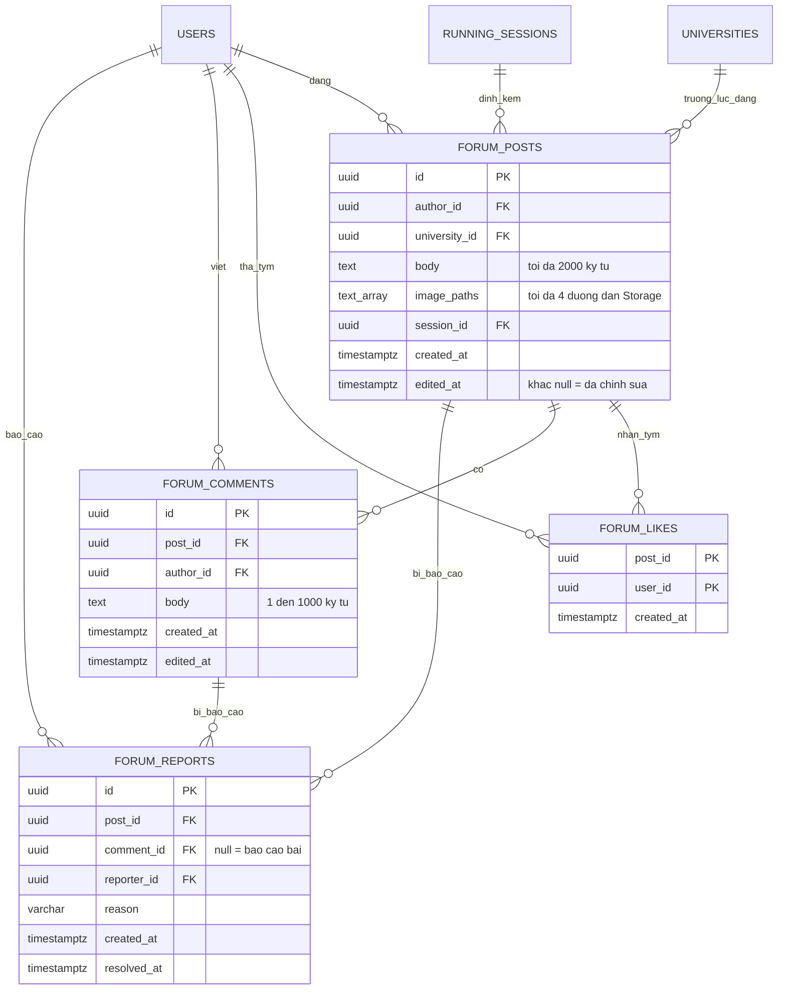

# SISO — YÊU CẦU NGHIỆP VỤ & THIẾT KẾ HỆ THỐNG
## ĐẶC TẢ PHẦN MỀM (SRS) & CƠ SỞ TRIỂN KHAI HỆ THỐNG
**Tên dự án:** SISO (Step In Step Out) — Mùa Giải Đại Chiến Đại Học TP. Hồ Chí Minh  
**Học phần:** Đồ án Thực tế Công nghệ Phần mềm (ĐACNPM)  
**Tiêu chuẩn áp dụng:** ISO/IEC/IEEE 29148:2018 (Tailored for Agile Location-based Gamified Mobile Projects)  
**Đơn vị thực hiện:** Nhóm 2 Kỹ sư Full-stack (Full-stack Pair — Cùng đảm nhiệm BE & FE theo phân rã chức năng)  
**Phiên bản tài liệu:** 4.0 — Mở rộng toàn TP.HCM  
**Ngày phát hành:** 27 tháng 11 năm 2026 (bản 3.0: 22/10/2026)  

---

### Mục đích sử dụng tài liệu
Tài liệu này xác định toàn bộ yêu cầu nghiệp vụ, kiến trúc hệ thống 3 tầng, đặc tả chức năng (FR), quy tắc nghiệp vụ (BR), yêu cầu phi chức năng (NFR), thiết kế CSDL không gian PostGIS, hợp đồng REST API & WebSocket, ma trận kiểm định Anti-GIGO và kế hoạch nghiệm thu cho hệ thống **SISO (Step In Step Out)**.

Tài liệu là căn cứ kỹ thuật pháp lý cao nhất để 2 thành viên trong nhóm phân chia công việc theo từng chức năng (Vertical Slices), tự kiểm thử (Unit/Integration Test) và bảo vệ sản phẩm trước Hội đồng đánh giá Đồ án Công nghệ Phần mềm.

| Thuộc tính | Nội dung |
| :--- | :--- |
| **Trạng thái** | Bản hoàn chỉnh (Approved Baseline) phục vụ phát triển 30 ngày và nghiệm thu đồ án. |
| **Nền tảng** | Client: Mobile Flutter (Dart 3.x) \| Backend: NestJS (TypeScript) Clean Architecture \| DB: Supabase (PostgreSQL 15 + PostGIS + pg_cron) \| Cache: Redis 7. |
| **Phạm vi** | Sinh viên các trường đại học / cao đẳng TP.HCM, xếp hạng theo 4 Cụm (Thủ Đức, Trung tâm, Bình Thạnh - Phú Nhuận - Gò Vấp, Khu Nam). Danh mục gốc 51 cơ sở; Sinh viên tự thêm Trường chưa có. 13 Đấu trường, mỗi Cụm có Đấu trường riêng (mục 1). |
| **Tên file** | Giữ tên `SRS_SISO_DA_CHIEN_BINH_THANH.md` để không gãy liên kết từ tài liệu khác, dù phạm vi đã mở rộng toàn TP.HCM. |
| **Cơ chế phân vai** | Không chia riêng BE/FE. Cả 2 kỹ sư đều là Full-stack: Mỗi kỹ sư chịu trách nhiệm trọn gói từ CSDL, API NestJS đến Giao diện/State Flutter cho từng nhóm chức năng cụ thể. |

### Lịch sử phiên bản

| Phiên bản | Ngày | Thay đổi chính | Nguồn |
| :--- | :--- | :--- | :--- |
| 3.0 | 22/10/2026 | Bản nền: 5 trường Bình Thạnh, đăng nhập email trường `@*.edu.vn`. | — |
| 4.0 | 27/11/2026 | (1) Đăng nhập email bất kỳ + OTP hoặc Google (Firebase); bỏ ràng buộc email trường. (2) Sinh viên tự chọn Trường; Trường là một cơ sở; Sinh viên tự thêm Trường chưa có. (3) Xếp hạng, % Lãnh thổ, % Km, Quán quân tính theo 4 Cụm; Đấu trường thuộc một Cụm. (4) Khoá Trường theo Mùa giải. (5) Diễn đàn: bài đăng có ảnh, đính kèm Phiên chạy, Tym, bình luận, báo cáo. (6) Bảng xếp hạng hiện thời gian còn lại của Mùa giải. (7) Bảng mã lỗi cập nhật theo code. (8) 9 Đấu trường mới cho Cụm Thủ Đức / Trung tâm / Khu Nam; danh mục gốc 51 cơ sở. | `GLOSSARY.md`, `docs/adr/0002-xep-hang-theo-cum-va-co-so.md`, `backend/src/database/init_schema.sql` mục 6C, 7, 12 |

> **Lưu ý phạm vi bản 4.0:** chỉ các mục liên quan tới 7 thay đổi trên được viết lại. Các điểm lệch có từ bản 3.0 nhưng không thuộc phạm vi này (thuật toán Cổng Sinh trắc mục 17 vẫn mô tả Zero-Crossing trong khi code dùng FFT; mục 19 trộn bước xử lý với trạng thái) được giữ nguyên và liệt kê ở cuối tài liệu.

---

## MỤC LỤC CHI TIẾT
- [a. Tổng quan dự án](#a)
  - [1. Mục tiêu, bối cảnh và 4 Cụm thi đấu](#a1)
  - [2. Elevator Pitch & Ý nghĩa tên gọi SISO](#a2)
  - [3. Phân tích đối thủ cạnh tranh & Khoảng trống thị trường](#a3)
  - [4. Luận điểm khoa học cốt lõi: Động cơ phòng thủ Anti-GIGO](#a4)
- [b. Kiến trúc dự án](#b)
  - [5. Mô hình 3 tầng độc lập (3-Tier Enterprise Architecture)](#b5)
  - [6. Phân bổ công nghệ & Vai trò trong hệ sinh thái](#b6)
  - [7. Sơ đồ luồng dữ liệu (Data Flow Diagram - DFD) & Trình tự](#b7)
- [c. Các chức năng và tính năng](#c)
  - [8. Danh mục Actors & Sơ đồ Use Case](#c8)
  - [9. Đặc tả Yêu cầu chức năng chi tiết (FR-01 đến FR-13)](#c9)
- [d. Thiết kế cơ sở dữ liệu](#d)
  - [10. Sơ đồ quan hệ thực thể (ERD)](#d10)
  - [11. Từ điển dữ liệu (Data Dictionary) & Script DDL](#d11)
  - [12. View tổng hợp bộ đếm song song theo Cụm (% Lãnh thổ & % Km)](#d12)
- [e. Thiết kế API & WebSocket](#e)
  - [13. Hợp đồng REST API v1 (NestJS Swagger OpenAPI 3.0)](#e13)
  - [14. Hợp đồng thời gian thực (Turf WebSocket Gateway)](#e14)
  - [15. Bảng mã lỗi hệ thống (System Error Codes)](#e15)
- [f. Thiết kế lập trình nghiệp vụ](#f)
  - [16. Bộ quy tắc nghiệp vụ bắt buộc (Business Rules BR01 - BR11)](#f16)
  - [17. Thuật toán kiểm định xe máy bằng biến đổi Fourier (Anti-GIGO FFT)](#f17)
  - [18. Thuật toán chiếm đất khép vòng trên đồ thị lục giác Uber H3](#f18)
- [g. Các trạng thái nghiệp vụ](#g)
  - [19. Vòng đời phiên chạy bộ (Running Session State Machine)](#g19)
  - [20. Vòng đời ô lục giác & Hao mòn tự nhiên (Hexagon Shield & 48h Decay)](#g20)
  - [21. Vòng đời Mùa giải & Quán quân theo Cụm](#g21)
- [h. Workflow luồng nghiệp vụ](#h)
  - [22. WF01: Đăng nhập bằng email (OTP) hoặc Google](#h22)
  - [23. WF02: Giám sát chạy ngầm & Lọc Kinematic Kalman](#h23)
  - [24. WF03: Kiểm định Biometric chống gian lận xe máy](#h24)
  - [25. WF04: Khép vòng chiếm đất tại Đấu trường & Broadcast](#h25)
  - [26. WF05: Chạy tự do cộng Quỹ Km](#h26)
  - [27. WF06: Bảng xếp hạng theo Cụm & thời gian Mùa giải](#h27)
  - [28. WF07: Đóng Mùa giải & vinh danh Quán quân từng Cụm](#h28)
  - [29. WF08: Chọn / đổi Trường và thêm Trường mới](#h29)
  - [30. WF09: Diễn đàn: đăng bài, Tym, bình luận, báo cáo](#h30)
  - [31. WF10: Quản trị viên duyệt / gộp Trường và kiểm duyệt Diễn đàn](#h31)
- [Phụ lục Phân quyền & Ma trận truy cập (RBAC)](#pl1)
- [Phụ lục Yêu cầu phi chức năng (NFR) & Phương pháp đo lường](#pl2)
- [Phụ lục Ma trận nghiệm thu đồ án (Verification & Acceptance Criteria)](#pl3)

---

<a id="a"></a>
## a. TỔNG QUAN DỰ ÁN

<a id="a1"></a>
### 1. Mục tiêu, bối cảnh và 4 Cụm thi đấu
Giai đoạn MVP (bản 3.0) có 5 Trường ở Bình Thạnh: HUTECH, UEF, UTH, FTU2, HIU. Từ bản 4.0, SISO mở cho Sinh viên mọi trường đại học / cao đẳng ở TP.HCM. Mỗi **Trường** (`universities`) là **một cơ sở thi đấu**: trường có nhiều cơ sở ở các khu khác nhau thì mỗi cơ sở là một Trường riêng (ví dụ "UEH Cơ sở A" ở Quận 3 và "UEH Cơ sở N" ở Bình Chánh), gom lại bằng `parent_name` để dùng chung thương hiệu. Lý do: một trường mẹ có cơ sở ở hai khu thì không xếp được vào một **Cụm** duy nhất (ADR-0002).

Trường thuộc Cụm theo quận của cơ sở (bảng `districts`, tên quận trước cải cách 7/2025). Quận nằm ngoài 4 Cụm gốc được gán vào Cụm gần nhất:

| Mã Cụm | Cụm | Quận gốc | Quận gán thêm |
| :--- | :--- | :--- | :--- |
| `THU_DUC` | Cụm Khu đô thị ĐHQG (TP. Thủ Đức - Khu Đông) | TP. Thủ Đức (Q2, Q9, Thủ Đức cũ) | Dĩ An (KĐT ĐHQG, Bình Dương cũ) |
| `CENTRAL` | Cụm Trung tâm | Quận 1, 3, 5, 10 | Quận 6, 11, Tân Phú, Bình Tân |
| `NORTH` | Cụm Bình Thạnh - Phú Nhuận - Gò Vấp (Khu Bắc & Đông Bắc) | Bình Thạnh, Phú Nhuận, Gò Vấp | Tân Bình, Quận 12, Hóc Môn, Củ Chi |
| `SOUTH` | Cụm Khu Nam | Quận 7, Bình Chánh | Quận 4, 8, Nhà Bè, Cần Giờ |

Danh mục gốc có 51 cơ sở (15 Thủ Đức, 17 Trung tâm, 13 Bình Thạnh - Phú Nhuận - Gò Vấp, 6 Khu Nam), trong đó 5 Trường MVP giữ nguyên màu và thuộc Cụm `NORTH`. Trường không có trong danh mục thì Sinh viên tự thêm (FR-09).

*Nguyên tắc an toàn thể thao:* ứng dụng không điều hướng Sinh viên chạy trên lòng đường; Đấu trường là các vùng mở (công viên, bờ sông, khu đô thị, khuôn viên) có ranh giới lấy từ OpenStreetMap, nới khoảng 45 m để gồm vỉa hè xung quanh (`backend/src/database/arenas.geojson`, nạp bằng `npm run seed:hexagons -- --apply`):

| Cụm | Đấu trường (số Ô đất H3 res 10) |
| :--- | :--- |
| `THU_DUC` | Khu Đô Thị ĐHQG quanh Nhà Văn hóa Sinh viên - Hồ Đá (69), Công Viên Bờ Sông Thủ Thiêm (19), Khu Đô Thị Vạn Phúc (136) |
| `CENTRAL` | Công Viên Tao Đàn (13), Phố Đi Bộ Nguyễn Huệ - Bến Bạch Đằng (40), Công Viên Lê Văn Tám (7) |
| `NORTH` | Khu Đô Thị Sala (52), Công Viên Landmark 81 (25), Khu Vực Bờ Kè Thanh Đa (56), Cụm Đại Học Bình Thạnh - Khu D2 (50) |
| `SOUTH` | Phú Mỹ Hưng - Hồ Bán Nguyệt & Crescent Park (13), Công Viên Nam Viên (7), Khu ĐH Tôn Đức Thắng - RMIT (29) |

> **Lưu ý lệch:** KĐT Sala nằm ở Thủ Thiêm (TP. Thủ Đức) nhưng được giữ ở Cụm `NORTH` vì là Đấu trường của giai đoạn MVP Bình Thạnh.

<a id="a2"></a>
### 2. Elevator Pitch & Ý nghĩa tên gọi SISO
**SISO (Step In Step Out)** là ứng dụng di động dạng **Gamified Running kết hợp Chiến thuật Đô thị Vị trí (Location-Based Turf War)**. Ứng dụng biến bản đồ thành phố thành bàn cờ lãnh thổ được chia thành hàng triệu ô lục giác chuẩn **Uber H3 Resolution 10** (~65m bán kính). Sinh viên chạy bộ khép kín các cung đường để nhuộm màu lãnh thổ cho trường mình trong mùa giải 30 ngày.

*Ý nghĩa 2 tầng:*
* **Tâm lý Người dùng:** *Step In* vào đường chạy cống hiến cho trường — *Step Out* khỏi phòng trọ lười biếng.
* **Học thuật CNPM:** Chơi chữ với nguyên lý kinh điển *Single Input Single Output* đối trọng trực tiếp với **GIGO (Garbage In, Garbage Out)**: Dù dữ liệu cảm biến đầu vào có nhiễu loạn hay gian lận xe máy (Garbage In), bộ lọc phòng thủ 4 tầng vẫn đảm bảo bảng xếp hạng minh bạch tuyệt đối (*Step In Valid, Step Out Pure*).

<a id="a3"></a>
### 3. Phân tích đối thủ cạnh tranh & Khoảng trống thị trường

| Tiêu chí | Strava | UpRace | Pokémon GO | **SISO (Đề tài của nhóm)** |
| :--- | :--- | :--- | :--- | :--- |
| **Đối tượng** | Vận động viên, runner nghiêm túc | Người chạy phong trào từ thiện | Game thủ bắt pet | **Sinh viên các trường đại học & Giới trẻ** |
| **Động lực giữ chân** | Áp lực Pace/PR cá nhân | Trách nhiệm xã hội ngắn hạn | Sưu tầm pet ảo | **Màu cờ sắc áo trường đại học (Campus Pride)** |
| **Chống xe máy** | Rất yếu (bị gian lận tràn lan) | Hậu kiểm thủ công / Lọc thô | Chỉ cảnh báo tốc độ cao | **Sensor Fusion IMU 50Hz + FFT thời gian thực** |
| **Cơ chế tương tác** | Đọc chỉ số, Kudos | Tích lũy km tập thể | Bắt mốc đơn lẻ | **Chiếm lãnh thổ trực quan theo lưới lục giác H3** |
| **Chu kỳ giải đấu** | Không có điểm kết thúc | 1 năm 1 lần | Không có Turf War | **Reset tự động chu kỳ 30 ngày (Monthly Season)** |

<a id="a4"></a>
### 4. Luận điểm khoa học cốt lõi: Động cơ phòng thủ Anti-GIGO
Hệ thống thiết lập **Bộ lọc phòng thủ 4 tầng** ngăn chặn triệt để mọi hành vi gian lận thể thao số tại Việt Nam:
* **Tầng 0 (Cổng Danh tính):** Chỉ tài khoản đã xác minh email (mã OTP gửi về hộp thư, hoặc đăng nhập Google qua Firebase) và đã chọn Trường mới được gửi dữ liệu chạy và chiếm đất (`NotBannedGuard`, `ERR_109`). Bản 3.0 yêu cầu email `@*.edu.vn`; bản 4.0 bỏ yêu cầu này, bù lại bằng luật khoá Trường theo Mùa giải (BR08).
* **Tầng 1 (Kinematic Gate):** Bộ lọc Kalman lọc sai số vệ tinh $> 15\text{m}$ và cổng chặn vận tốc tối đa con người ($v \le 9\text{ m/s} = 32.4\text{ km/h}$). Loại bỏ nhảy vọt tọa độ (GPS drift).
* **Tầng 2 (Biometric Gate):** Thu thập gia tốc kế IMU 3 trục ($50\text{Hz}$), biến đổi Fourier nhanh (FFT) trên cửa sổ 256 mẫu ($5.12\text{s}$) để tìm tần số đỉnh $f_{\text{peak}}$. Người chạy bộ thật: $f \in [2.3\text{Hz}, 3.3\text{Hz}]$ ($138-198\text{ spm}$), biên độ $> 0.6G$. Người đi xe máy rà chậm 12km/h: $f > 8\text{Hz}$ (rung máy), biên độ đứng $< 0.25G \rightarrow$ Chặn đứng và hủy phiên chạy (`ERR_202`).
* **Tầng 3 (Topology Gate):** Chuẩn hóa tọa độ thành chuỗi ô lục giác Uber H3 và thuật toán Loang (Flood Fill) chu trình kín, áp trần an toàn 150 ô (`ERR_301`).

---

<a id="b"></a>
## b. KIẾN TRÚC DỰ ÁN

<a id="b5"></a>
### 5. Mô hình 3 tầng độc lập (3-Tier Enterprise Architecture)
Để đạt điểm xuất sắc trước Hội đồng Đồ án Thực tế CNPM, hệ thống không dùng Backend-as-a-Service trọn gói mà phân rã thành **3 tầng độc lập**:

```
┌────────────────────────────────────────────────────────────────────────┐
│                   1. PRESENTATION TIER (Mobile Client)                 │
│   Flutter (Dart 3.x)  │  flutter_map + CartoDB  │  h3_flutter          │
│   sensors_plus (50Hz) │  geolocator             │  Riverpod + Dio      │
└───────────────────────────────────┬────────────────────────────────────┘
                                    │ HTTPS (REST) / WSS (WebSocket)
┌───────────────────────────────────▼────────────────────────────────────┐
│                  2. LOGIC & APPLICATION TIER (NestJS API)              │
│   NestJS (TypeScript) │  Clean Architecture     │  Swagger OpenAPI 3.0 │
│   Anti-GIGO FFT Engine│  H3 Spatial Flood Fill  │  Socket.io Gateway   │
│   JWT Auth & RBAC     │  TypeORM Data Layer     │  Redis Pub/Sub Cache │
└───────────────────────────────────┬────────────────────────────────────┘
                                    │ TCP / SSL Connection Pool (:5432)
┌───────────────────────────────────▼────────────────────────────────────┐
│                    3. DATA TIER (Cloud Infrastructure)                 │
│   Supabase Cloud Platform (Managed PostgreSQL 15)                      │
│   PostGIS Spatial Extension  │  pg_cron Automated Monthly Reset        │
│   h3_hexagons Table (B-Tree) │  v_campus_live_scores Realtime View     │
└────────────────────────────────────────────────────────────────────────┘
```

<a id="b6"></a>
### 6. Phân bổ công nghệ & Vai trò trong hệ sinh thái

| Thành phần | Công nghệ | Vai trò & Lý do lựa chọn |
| :--- | :--- | :--- |
| **Mobile Client** | **Flutter (Dart 3.x)** | Đồ họa Impeller mượt mà 60 FPS khi render hàng trăm ô lục giác; truy cập trực tiếp phần cứng CoreMotion/Sensors; 1 codebase cho iOS & Android. |
| **Bản đồ & Không gian** | **`flutter_map` + CartoDB** | Hoàn toàn miễn phí, không phụ thuộc thẻ tín dụng Google Maps SDK, tùy biến layer lục giác dễ dàng. |
| **Chỉ mục Không gian** | **Uber H3 (`h3-js` & `h3_flutter`)** | Mã hóa không gian thành chuỗi 15 ký tự; tính toán quan hệ kề cận $O(1)$; chia ô đều diện tích không méo góc ở vĩ độ TP.HCM. |
| **Backend Server** | **NestJS (TypeScript)** | Enterprise Clean Architecture; tự động sinh Swagger UI; quản lý WebSocket Gateway tập trung; làm chủ thuật toán Anti-GIGO và Flood Fill. |
| **Database Cloud** | **Supabase (PostgreSQL 15 + PostGIS)** | Hạ tầng CSDL đám mây 24/7; hỗ trợ tính toán không gian PostGIS; `pg_cron` tự động hóa tác vụ reset mùa giải lúc 00:00 ngày đầu tháng. |
| **Realtime Engine** | **Socket.io + Redis** | Đồng bộ đổi màu bản đồ theo mili-giây qua WebSocket khi có sự kiện chiếm đất thành công. |

<a id="b7"></a>
### 7. Sơ đồ luồng dữ liệu (Data Flow Diagram - DFD) & Trình tự



---

<a id="c"></a>
## c. CÁC CHỨC NĂNG VÀ TÍNH NĂNG

<a id="c8"></a>
### 8. Danh mục Actors & Sơ đồ Use Case
* **Sinh viên:** đăng nhập, chọn Trường, chạy khép vòng ở Đấu trường thuộc Cụm của Trường mình hoặc Chạy tự do ở bất kỳ đâu, xem Bảng xếp hạng và dùng Diễn đàn. Sinh viên chưa chọn Trường chỉ xem được Bảng xếp hạng và Diễn đàn.
* **Hệ thống Tự động (pg_cron):** Hao mòn Ô đất (mỗi giờ), kết thúc Phiên bỏ dở (mỗi 5 phút), đóng Mùa giải và ghi Quán quân từng Cụm (mỗi ngày 00:00 giờ Việt Nam).
* **Quản trị viên:** xử lý nhật ký Anti-GIGO, khoá Sinh viên, quản lý Mùa giải / Trường / Đấu trường, duyệt và gộp Trường Sinh viên tự thêm, kiểm duyệt Diễn đàn (web admin).



> **Lưu ý lệch:** đánh số UC-03 / UC-04 ở đây theo SRS bản 3.0; Timeline v3 đánh UC-03 = Giám sát & lọc Kinematic, UC-04 = Anti-GIGO, UC-05 = Chiếm đất. UC-09 đến UC-11 là UC mới của bản 4.0, chưa có trong Timeline.

<a id="c9"></a>
### 9. Đặc tả Yêu cầu chức năng chi tiết (Functional Requirements)

| Mã FR | Tên chức năng | Đặc tả chi tiết | Tiêu chí nghiệm thu (Acceptance Criteria) |
| :--- | :--- | :--- | :--- |
| **FR-01** | Đăng nhập bằng email (OTP) hoặc Google | (a) Email bất kỳ: `POST /auth/email-login` gửi OTP 6 số (hạn 5 phút, gửi lại sau 60 s, khoá sau 5 lần sai), `POST /auth/verify-otp` cấp JWT 7 ngày. (b) Google: ứng dụng đăng nhập Firebase Auth rồi gửi Firebase ID token tới `POST /auth/google`; backend kiểm tra bằng `firebase-admin` và cấp JWT SISO. Cùng email (đã chuẩn hoá chữ thường) là cùng một tài khoản. Tài khoản mới chưa có Trường. | Gmail nhận được OTP và đăng nhập được. Google token sai trả `ERR_111`; server chưa cấu hình Firebase trả `ERR_110`. Đăng nhập lần đầu đưa tới màn chọn Trường. |
| **FR-02** | Giám sát & Lọc Kinematic | Thu thập GPS mỗi 1s và gia tốc 3 trục $50\text{Hz}$. Khử nhiễu dội sóng: nếu sai số vệ tinh $> 15\text{m}$ hoặc gia tốc nhảy vọt $> 9\text{ m/s}$ ($32.4\text{ km/h}$) thì bỏ qua điểm. | Không sinh ra các điểm nhảy cóc tọa độ xuyên qua nhà cao tầng. |
| **FR-03** | Động cơ Anti-GIGO FFT | Phân tích 256 mẫu gia tốc ($5.12\text{s}$) bằng biến đổi Fourier tìm tần số đỉnh $f_{\text{peak}}$. Phân biệt người chạy bộ ($f \in [2.3, 3.3]\text{Hz}$, biên độ $> 0.6G$) và người đi xe máy rà chậm 12km/h ($f > 8\text{Hz}$, biên độ $< 0.25G$). | Nếu vận tốc $\ge 2.5\text{ m/s}$ ($9\text{ km/h}$) nhưng nhịp bước $< 120\text{ SPM} \rightarrow$ Từ chối và ghi mã `ERR_202`. Phát hiện Fake GPS ghi mã `ERR_201`. |
| **FR-04** | Chiếm đất khép vòng H3 | Chuyển tọa độ thành Ô đất H3 Res 10. Khi tọa độ hiện tại tiếp giáp điểm xuất phát thì kích hoạt Vòng khép. Server chạy flood fill tìm các Ô đất bên trong và gán cho Trường. Chỉ Đấu trường thuộc **cùng Cụm** với Trường của Sinh viên mới bị tác động; khu thi đấu Bình Thạnh (không gửi `arenaId`) thuộc Cụm `NORTH`. | Từ chối nếu vượt 150 ô (`ERR_301`), ra ngoài Đấu trường (`ERR_304`), lệch Đường chạy (`ERR_305`) hoặc Đấu trường thuộc Cụm khác (`ERR_306`, Phiên chạy vẫn kết thúc như Chạy tự do). |
| **FR-05** | Chạy tự do cộng Quỹ Km | Sinh viên chạy ở bất kỳ đâu không khép được Vòng khép trong Đấu trường của Cụm mình (kể cả ở Cụm khác hoặc ngoài TP.HCM). Phiên chạy qua Anti-GIGO được cộng vào Quỹ Km của Trường. | Màn hình hiển thị số km vừa cộng cho Trường. |
| **FR-06** | Bộ đếm phần trăm song song theo Cụm | Hai thước đo tính **trong từng Cụm**: (1) **% Lãnh thổ** = Ô đất của Trường trong các Đấu trường đang hoạt động của Cụm / tổng Ô đất các Đấu trường đó; (2) **% Km** = Quỹ Km của Trường / tổng Quỹ Km các Trường cùng Cụm. Sức mạnh Tổng hợp $= 50\%$ % Lãnh thổ $+ 50\%$ % Km; Cụm chưa có Đấu trường thì Sức mạnh Tổng hợp $=$ % Km. | View `v_campus_live_scores` trả thêm `cluster_code`, `cluster_has_arena`; `GET /leaderboard/scores?cluster=` lọc theo Cụm. |
| **FR-07** | Đồng bộ Realtime WebSocket | Khi một đội chiếm đất, Backend phát sự kiện `hex_claimed` qua WebSocket tới toàn bộ client đang mở app trong khu vực. | Bản đồ trên máy sinh viên trường khác đổi màu ngay lập tức với độ trễ $< 300\text{ms}$. |
| **FR-08** | Hao mòn 48h & đóng Mùa giải | Ô đất về Độ bền 50 sau 24 giờ không Tuần tra; về Trung lập sau 48 giờ. Khi Mùa giải hết hạn, `pg_cron` ghi **một Quán quân cho mỗi Cụm** vào `hall_of_fame` (`cluster_code`), đưa mọi Ô đất về Trung lập, đặt Quỹ Km và Km cá nhân về 0, mở Mùa mới tới cuối tháng. | Tự động chạy trong CSDL; Cụm không có hoạt động (điểm 0) không có Quán quân. |
| **FR-09** | Chọn Trường & thêm Trường mới | Sau lần đăng nhập đầu tiên, ứng dụng bắt buộc chọn Trường (Quản trị viên được bỏ qua). Ô tìm kiếm gợi ý không phân biệt dấu theo tên, tên ngắn, thương hiệu, từ khoá và quận (`GET /universities`). Không thấy thì Sinh viên nhập tên đầy đủ, tên viết tắt, chọn quận; Trường mới được tạo và **tính điểm ngay** với `is_verified = false`. Tên trùng (bỏ dấu, không phân biệt hoa thường) hoặc trùng tên ngắn cùng quận thì dùng Trường có sẵn. | `PUT /universities/mine` trả JWT và hồ sơ mới. Quận ngoài danh sách trả `ERR_113`. Chưa chọn Trường mà gửi telemetry / chiếm đất / viết Diễn đàn trả `ERR_109`. |
| **FR-10** | Khoá Trường theo Mùa giải | Chọn Trường khi chưa có thì khoá đến hết Mùa đó (`users.university_season`). Sang Mùa mới, ứng dụng hỏi một lần "Ở lại hay đổi Trường?"; không trả lời thì coi như ở lại; được đổi cho tới Phiên chạy hợp lệ đầu tiên của Mùa. Km đã cộng vẫn thuộc Trường cũ. | Đổi khi đang khoá trả `ERR_112` kèm lý do; chọn lại đúng Trường đang có không khoá thêm. `/auth/me` trả `canChangeUniversity`, `seasonNumber`. |
| **FR-11** | Bảng xếp hạng theo Cụm & thời gian Mùa giải | Bảng xếp hạng mặc định mở Cụm của Sinh viên, có chip chọn Cụm khác; Đại sảnh Danh vọng lọc theo Cụm. Đầu màn hiện "Mùa N · còn X ngày Y giờ · kết thúc dd/mm" (`GET /leaderboard/season`), đếm tới hết ngày `end_date` giờ Việt Nam; còn dưới 24 giờ thì đổi màu cảnh báo. | Không có Mùa mở thì hiện "Đang chờ mùa mới"; quá hạn mà chưa đóng thì "đang tổng kết". |
| **FR-12** | Diễn đàn | Bảng tin chung, lọc Tất cả / Cụm của tôi / Trường của tôi, phân trang theo thời gian. Bài đăng gồm chữ ($\le 2000$ ký tự), tối đa 4 ảnh JPEG/PNG/WebP ($\le 1$ MB mỗi ảnh, lưu ở Supabase Storage bucket `forum`) và tuỳ chọn một Phiên chạy hợp lệ của chính tác giả (km, thời gian, pace do server kiểm định). Mỗi Sinh viên một Tym mỗi bài. Bình luận một tầng. Tác giả sửa / xoá bài và bình luận của mình; bài đã sửa hiện "đã chỉnh sửa"; xoá bài xoá luôn ảnh, Tym, bình luận. Báo cáo bài hoặc bình luận cho Quản trị viên. | Lỗi: `ERR_104` ảnh sai loại / quá 1 MB, `ERR_114` server chưa bật lưu ảnh, `ERR_115` bài rỗng / quá 4 ảnh, `ERR_116` Phiên chạy đính kèm không hợp lệ, `ERR_117` không phải tác giả. Sinh viên chưa chọn Trường chỉ xem. |
| **FR-13** | Quản trị Trường & kiểm duyệt Diễn đàn | Web admin: thêm / sửa Trường (mã, tên ngắn, tên, quận, thương hiệu, từ khoá, màu); duyệt Trường Sinh viên tự thêm; **gộp** Trường trùng (chuyển Sinh viên, Ô đất, Quỹ Km, Quán quân sang Trường giữ lại rồi xoá); xoá Trường chưa có Sinh viên. Xem báo cáo Diễn đàn, bỏ qua báo cáo hoặc xoá bài / bình luận. | Mọi thao tác ghi `admin_actions` trong cùng transaction. |

---

<a id="d"></a>
## d. THIẾT KẾ CƠ SỞ DỮ LIỆU

<a id="d10"></a>
### 10. Sơ đồ quan hệ thực thể (ERD)
ERD theo `backend/src/database/init_schema.sql` (bản 4.0). Tách hai hình: thi đấu và Diễn đàn. Các bảng phụ trợ `session_windows`, `gigo_audit_logs`, `admin_actions`, `user_avatars` không vẽ lại ở đây.


*Hình 10-1. ERD phân hệ thi đấu (Trường, Cụm, Đấu trường, Ô đất, Phiên chạy, Mùa giải).*

Mỗi Trường (cơ sở) nằm ở một quận, quận thuộc một Cụm; đổi Cụm của một quận chỉ cần sửa một dòng `districts`. Đấu trường và Quán quân cũng gắn với Cụm (unique `(season_number, cluster_code)` trên `hall_of_fame`). `users.university_season` lưu Mùa giải lúc chọn Trường để áp luật khoá (BR08).


*Hình 10-2. ERD phân hệ Diễn đàn.*

Bài đăng giữ `university_id` lúc đăng để lọc theo Trường / Cụm. Xoá bài xoá theo Tym, bình luận và báo cáo (`ON DELETE CASCADE`); ảnh trên Storage do backend xoá sau khi commit. Báo cáo trùng (cùng mục, cùng người) bị bỏ qua nhờ unique index trên `(post_id, COALESCE(comment_id, …), reporter_id)`.

<a id="d11"></a>
### 11. Từ điển dữ liệu (Data Dictionary) & Script DDL
*Vị trí lưu trữ:* `backend/src/database/init_schema.sql` (mục 1–5 bảng gốc, 6C Cụm / quận / Trường theo cơ sở, 7 view, 12 Diễn đàn). Dưới đây chỉ trích các bảng và cột mới của bản 4.0.

**Bảng `clusters`** – Cụm.

| Cột | Kiểu | Ràng buộc | Mặc định | Mô tả |
|---|---|---|---|---|
| `code` | `VARCHAR(20)` | PK | | `THU_DUC`, `CENTRAL`, `NORTH`, `SOUTH` |
| `name` | `VARCHAR(100)` | NOT NULL | | Tên hiển thị |
| `sort_order` | `INT` | NOT NULL | 0 | Thứ tự trên màn hình |

**Bảng `districts`** – quận (tên trước 7/2025) và Cụm của nó.

| Cột | Kiểu | Ràng buộc | Mặc định | Mô tả |
|---|---|---|---|---|
| `name` | `VARCHAR(60)` | PK | | Vd. `Quận 3`, `TP. Thủ Đức (Q2, Q9, Thủ Đức cũ)` |
| `cluster_code` | `VARCHAR(20)` | NOT NULL, FK `clusters` | | Cụm |
| `sort_order` | `INT` | NOT NULL | 0 | Thứ tự trong danh sách chọn |

**Cột mới của `universities`** – Trường (một cơ sở thi đấu).

| Cột | Kiểu | Ràng buộc | Mặc định | Mô tả |
|---|---|---|---|---|
| `email_domain` | `VARCHAR(50)` | UNIQUE, **cho phép NULL** | | Không còn dùng để đăng nhập |
| `district` | `VARCHAR(60)` | FK `districts` (ON UPDATE CASCADE) | | Quyết định Cụm |
| `parent_name` | `VARCHAR(60)` | | | Thương hiệu chung, vd. `UEH` |
| `aliases` | `TEXT` | | | Từ khoá tìm thêm, không dấu |
| `is_verified` | `BOOLEAN` | NOT NULL | `TRUE` | `FALSE` = Sinh viên tự thêm, chờ duyệt |
| `created_by` | `UUID` | FK `users` (ON DELETE SET NULL) | | Người thêm |

Chỉ mục: `uq_universities_name_ci` trên (`lower(name)`) – chặn tên trùng khi Sinh viên tự thêm.

**Cột mới khác**

| Bảng | Cột | Kiểu | Mô tả |
|---|---|---|---|
| `users` | `university_season` | `INT` | Mùa giải lúc chọn Trường gần nhất; NULL = chọn trước khi có luật khoá |
| `arenas` | `cluster_code` | `VARCHAR(20)` NOT NULL, FK `clusters`, mặc định `NORTH` | Cụm của Đấu trường |
| `hall_of_fame` | `cluster_code` | `VARCHAR(20)`, FK `clusters` | Cụm của Quán quân; unique `(season_number, cluster_code)` (`uq_hof_season_cluster`, file `season_automation.sql`) |

**Bảng Diễn đàn** (`forum_posts`, `forum_likes`, `forum_comments`, `forum_reports`): cột như Hình 10-2. Ràng buộc chính: `forum_posts_not_empty` (có chữ hoặc có ảnh), `cardinality(image_paths) <= 4`, `char_length(body) <= 2000`; bình luận 1–1000 ký tự. Bốn bảng bật RLS và không có policy: chỉ backend đọc / ghi. Bucket Storage `forum` (public đọc, `file_size_limit` 1 MB, chỉ `image/jpeg`, `image/png`, `image/webp`) tạo cùng khối SQL.

Trigger `assign_university_id` (bản 3.0, ép `university_id` theo đuôi email và chặn email ngoài 5 trường) đã bị xoá.

<a id="d12"></a>
### 12. View tổng hợp bộ đếm song song theo Cụm (% Lãnh thổ & % Km)

```sql
CREATE OR REPLACE VIEW public.v_campus_live_scores
WITH (security_invoker = true)
AS
WITH uni AS (
    SELECT u.*, d.cluster_code
    FROM public.universities u
    LEFT JOIN public.districts d ON d.name = u.district
),
hex AS (
    -- Ô đất không gắn Đấu trường (khu thi đấu Bình Thạnh) tính vào Cụm NORTH
    SELECT h.owner_university_id, COALESCE(a.cluster_code, 'NORTH') AS cluster_code
    FROM public.h3_hexagons h
    LEFT JOIN public.arenas a ON a.id = h.arena_id
    WHERE a.id IS NULL OR a.is_active
),
cluster_hexes AS (SELECT cluster_code, COUNT(*)::FLOAT AS total_hexes FROM hex GROUP BY cluster_code),
owned AS (
    SELECT owner_university_id, cluster_code, COUNT(*)::FLOAT AS owned_hexes
    FROM hex WHERE owner_university_id IS NOT NULL
    GROUP BY owner_university_id, cluster_code
),
cluster_km AS (SELECT cluster_code, SUM(total_season_km)::FLOAT AS cluster_km FROM uni GROUP BY cluster_code),
pct AS (
    SELECT u.*,
           COALESCE(o.owned_hexes / NULLIF(ch.total_hexes, 0), 0) AS t,
           COALESCE(u.total_season_km / NULLIF(ck.cluster_km, 0), 0) AS m,
           COALESCE(ch.total_hexes, 0) > 0 AS has_arena
    FROM uni u
    LEFT JOIN owned o ON o.owner_university_id = u.id AND o.cluster_code = u.cluster_code
    LEFT JOIN cluster_hexes ch ON ch.cluster_code = u.cluster_code
    LEFT JOIN cluster_km ck ON ck.cluster_code = u.cluster_code
)
SELECT p.id AS university_id, p.name, COALESCE(p.short_name, p.short_code) AS short_name,
       p.hex_color, p.total_season_km,
       COALESCE(ROUND((p.t * 100)::NUMERIC, 2), 0.0) AS territory_pct,
       COALESCE(ROUND((p.m * 100)::NUMERIC, 2), 0.0) AS mileage_pct,
       COALESCE(ROUND(((CASE WHEN p.has_arena THEN 0.5 * p.t + 0.5 * p.m ELSE p.m END) * 100)::NUMERIC, 2), 0.0)
           AS composite_power_pct,
       p.short_code, p.cluster_code, p.has_arena AS cluster_has_arena
FROM pct p;
```

Gọi $H_c$ là số Ô đất thuộc các Đấu trường đang hoạt động của Cụm $c$, $h_u$ là số Ô đất Trường $u$ giữ trong các Đấu trường đó, $K_c$ là tổng Quỹ Km các Trường của Cụm $c$, $k_u$ là Quỹ Km của Trường $u$. Khi đó % Lãnh thổ $= h_u / H_c$, % Km $= k_u / K_c$, và Sức mạnh Tổng hợp $= 0{,}5 \cdot h_u/H_c + 0{,}5 \cdot k_u/K_c$ nếu $H_c > 0$, ngược lại bằng $k_u/K_c$. Ô đất một Trường giữ ở Đấu trường của Cụm khác không được tính.

---

<a id="e"></a>
## e. THIẾT KẾ API & WEBSOCKET

<a id="e13"></a>
### 13. Hợp đồng REST API v1 (NestJS Swagger OpenAPI 3.0)
Tất cả endpoint có tiền tố `/api/v1`, dữ liệu trao đổi bằng JSON. Swagger UI trực quan chạy tại `http://localhost:3000/docs`.

| Phương thức | Endpoint | Bảo vệ | Chức năng & Payload |
| :--- | :--- | :--- | :--- |
| `POST` | `/api/v1/auth/email-login` | Public | Body: `{ email }` (email bất kỳ). Gửi OTP 6 số. Trả `university` nếu tài khoản đã có Trường. |
| `POST` | `/api/v1/auth/verify-otp` | Public | Body: `{ email, otp }`. Trả `accessToken` (JWT 7 ngày) và `user`. |
| `POST` | `/api/v1/auth/google` | Public | Body: `{ idToken }` (Firebase ID token). Trả `accessToken` và `user`. |
| `GET` | `/api/v1/auth/me` | Bearer JWT | Hồ sơ mới nhất (`university` kèm `clusterCode`, `canChangeUniversity`, `seasonNumber`) và token gia hạn. |
| `GET` | `/api/v1/universities` | Public | `{ clusters, districts, universities }` cho màn chọn Trường. |
| `PUT` | `/api/v1/universities/mine` | Bearer JWT | Body: `{ universityId }` hoặc `{ name, shortName, district }`. Chọn / đổi / thêm Trường; trả JWT mới. |
| `POST` | `/api/v1/telemetry/verify` | Bearer JWT + đã chọn Trường | Một Cửa sổ telemetry (GPS + 256 mẫu IMU), chạy Anti-GIGO. |
| `POST` | `/api/v1/telemetry/finish` | Bearer JWT + đã chọn Trường | Kết thúc Phiên chạy, cộng Quỹ Km. |
| `GET` | `/api/v1/telemetry/sessions`, `/sessions/:id` | Bearer JWT | Lịch sử Phiên chạy, chi tiết Đường chạy. |
| `GET` | `/api/v1/turf/arenas`, `/turf/hexagons` | Public | Đấu trường đang hoạt động; trạng thái Ô đất (`?arenaId=`). |
| `POST` | `/api/v1/turf/claim-loop` | Bearer JWT + đã chọn Trường | Body: `{ boundaryH3Indexes, sessionId, arenaId? }`. Chiếm đất khép vòng trong Đấu trường cùng Cụm. |
| `GET` | `/api/v1/leaderboard/scores` | Public | `?cluster=` lọc theo Cụm (bỏ trống = mọi Cụm). |
| `GET` | `/api/v1/leaderboard/season` | Public | Mùa giải đang mở: `season_number`, `end_date`, `ends_at` (hết ngày `end_date` giờ Việt Nam). |
| `GET` | `/api/v1/leaderboard/hall-of-fame` | Public | `?cluster=` Quán quân từng Cụm các Mùa đã qua. |
| `GET` / `PATCH` | `/api/v1/profile` | Bearer JWT | Hồ sơ, đổi nickname. `PUT /profile/avatar`, `GET /profile/avatar/:userId` cho ảnh đại diện. |
| `GET` | `/api/v1/forum/posts`, `/forum/posts/:id` | Bearer JWT | Bảng tin (`?cluster=`, `?universityId=`, `?before=`, `?limit=`), chi tiết bài. |
| `POST` | `/api/v1/forum/posts` | Bearer JWT + đã chọn Trường | Multipart: `body`, `sessionId?`, tối đa 4 file `images`. |
| `PATCH` / `DELETE` | `/api/v1/forum/posts/:id` | Bearer JWT (tác giả) | Sửa (`body`, `sessionId` hoặc `""`, `keepImages` JSON, `images` mới) / xoá bài. |
| `PUT` / `DELETE` | `/api/v1/forum/posts/:id/like` | Bearer JWT + đã chọn Trường | Thả / bỏ Tym; trả `likeCount`. |
| `GET` / `POST` | `/api/v1/forum/posts/:id/comments` | Bearer JWT (viết: đã chọn Trường) | Danh sách / thêm bình luận. `PATCH` / `DELETE /forum/comments/:id` cho tác giả. |
| `POST` | `/api/v1/forum/posts/:id/report` | Bearer JWT | Body: `{ commentId?, reason? }`. Báo cáo bài hoặc bình luận. |
| * | `/api/v1/admin/*` | Bearer JWT + `role = admin` | Chống gian lận, thống kê, Mùa giải, Trường (`POST .../universities/:id/verify`, `.../merge`), Đấu trường, Sinh viên, Diễn đàn (`GET forum/reports`, `POST forum/reports/:id/dismiss`, `DELETE forum/posts/:id`, `DELETE forum/comments/:id`). |

<a id="e14"></a>
### 14. Hợp đồng thời gian thực (Turf WebSocket Gateway)
* **Namespace:** `/turf-ws` (Socket.io)
* **Event Lắng nghe từ Client:**
  * `hex_claimed`: Khi một đội chiếm ô lục giác thành công, server broadcast tới toàn bộ client:
    ```json
    {
      "universityId": "b5f67b4e-28c4-42b7-a35b-c2e3919e913a",
      "universityCode": "HUTECH",
      "hexColor": "#FFCC00",
      "claimedHexes": ["8a31e8464627fff", "8a31e846460ffff"],
      "arenaId": "11111111-1111-4111-8111-111111111111",
      "claimedAt": "2026-11-04T10:00:00.000Z"
    }
    ```

<a id="e15"></a>
### 15. Bảng mã lỗi hệ thống (System Error Codes)

| Mã lỗi | Tên mã | Nguyên nhân kích hoạt | Phản hồi ứng dụng |
| :--- | :--- | :--- | :--- |
| ~~`ERR_101`~~ | `INVALID_DOMAIN` | **Ngừng dùng từ bản 4.0** (đăng nhập nhận mọi email). | — |
| `ERR_102` | `OTP_INVALID` | OTP sai hoặc hết hạn 5 phút | Báo sai, xoá ô nhập, hiện số lần thử còn lại. |
| `ERR_103` | `OTP_LOCKED` | Sai 5 lần, hoặc gửi lại mã trong 60 s | Yêu cầu chờ và gửi mã mới. |
| `ERR_104` | `IMAGE_INVALID` | Ảnh đại diện / ảnh Diễn đàn không phải JPEG/PNG/WebP hoặc quá giới hạn (512 KB / 1 MB) | Báo chọn ảnh khác. |
| `ERR_105` | `AVATAR_NOT_FOUND` | Sinh viên chưa có ảnh đại diện | Hiện chữ cái đầu tên. |
| `ERR_106` | `ACCOUNT_BANNED` | Tài khoản đang bị Quản trị viên khoá | Chặn gửi telemetry, kết thúc phiên, chiếm đất, viết Diễn đàn. |
| `ERR_107` | `NOT_ADMIN` | Gọi `/admin/*` mà không phải admin | Web admin về trang đăng nhập. |
| `ERR_108` | `ADMIN_CONFLICT` | Thao tác admin xung đột dữ liệu (trùng mã, Trường còn Sinh viên…) | Báo lý do. |
| `ERR_109` | `NO_UNIVERSITY` | Chưa chọn Trường | Mở màn chọn Trường. |
| `ERR_110` | `GOOGLE_DISABLED` | Server chưa cấu hình Firebase | Báo dùng email. |
| `ERR_111` | `GOOGLE_TOKEN_INVALID` | Firebase ID token sai / hết hạn, hoặc email chưa xác minh | Báo thử lại. |
| `ERR_112` | `UNIVERSITY_LOCKED` | Đổi Trường khi đang khoá theo Mùa giải | Hiện lý do và Mùa được đổi. |
| `ERR_113` | `INVALID_DISTRICT` | Quận không có trong danh sách khi thêm Trường | Yêu cầu chọn quận trong danh sách. |
| `ERR_114` | `FORUM_STORAGE_OFF` | Server chưa cấu hình lưu ảnh Diễn đàn | Chỉ đăng được bài chữ. |
| `ERR_115` | `POST_EMPTY` | Bài không có chữ lẫn ảnh, hoặc quá 4 ảnh | Báo cần nội dung / bớt ảnh. |
| `ERR_116` | `RUN_NOT_ATTACHABLE` | Phiên chạy đính kèm không phải của tác giả hoặc chưa hợp lệ | Báo chọn Phiên khác. |
| `ERR_117` | `NOT_AUTHOR` | Sửa / xoá bài hoặc bình luận của người khác | Báo không có quyền. |
| `ERR_201` | `MOCK_GPS_DETECTED` | Phát hiện phần mềm giả lập tọa độ | Hủy phiên chạy, ghi nhận cờ nghi vấn. |
| `ERR_202` | `VEHICLE_SPEED_MISMATCH` | Tốc độ cao nhưng Nhịp bước không khớp (xe máy) | Hủy phiên chạy, cảnh báo yêu cầu chạy bộ thật. |
| `ERR_203` | `GPS_ACCURACY_LOW` | Sai số vệ tinh $> 20\text{m}$ (trong nhà / hầm xe) | Tạm dừng đo, hiển thị "Đang tìm tín hiệu vệ tinh...". |
| `ERR_204` | `SESSION_NOT_FOUND` | `sessionId` không tồn tại, của Sinh viên khác, hoặc Phiên chạy đã kết thúc | Bắt đầu Phiên chạy mới. |
| `ERR_205` | `INVALID_SIGNATURE` | Cửa sổ cảm biến sai chữ ký HMAC-SHA256 hoặc gửi lại cửa sổ cũ | Hủy phiên chạy, ghi nhật ký GIGO. |
| `ERR_206` | `INVALID_GPS_POINTS` | Điểm GPS nằm ngoài thời gian của Cửa sổ | Bỏ Cửa sổ đó, Phiên chạy tiếp tục. |
| `ERR_207` | `WINDOW_TOO_EARLY` | Cửa sổ đến sớm hơn thời gian thật (gửi dồn) | Bỏ Cửa sổ đó, Phiên chạy tiếp tục. |
| `ERR_301` | `LOOP_TOO_LARGE` | Vòng khép vượt giới hạn an toàn 150 ô H3 | Từ chối chiếm đất, yêu cầu khép vòng trong phạm vi nhỏ hơn. |
| `ERR_302` | `SELF_INTERSECT` | Đường chạy tự cắt chéo hình số 8 không tạo chu trình đơn | Bỏ qua điểm cắt, tiếp tục ghi nhận vệt chạy. |
| `ERR_303` | `ARENA_NOT_FOUND` | `arenaId` không tồn tại hoặc Đấu trường đã tắt | Tải lại danh sách Đấu trường. |
| `ERR_304` | `OUT_OF_ARENA` | Vòng khép có ô nằm ngoài Đấu trường | Từ chối chiếm đất. |
| `ERR_305` | `ROUTE_MISMATCH` | Đường biên Vòng khép không khớp Đường chạy thật | Từ chối chiếm đất. |
| `ERR_306` | `OTHER_CLUSTER` | Đấu trường thuộc Cụm khác Cụm của Trường | Không chiếm đất; Phiên chạy kết thúc như Chạy tự do. |

Nguồn: `throw ... { code: 'ERR_xxx' }` trong `backend/src/**`, bản sao phía app ở `lib/src/core/errors/siso_exceptions.dart`. Cột *Tên mã* là nhãn tài liệu; API chỉ trả mã số và thông báo tiếng Việt.

---

<a id="f"></a>
## f. THIẾT KẾ LẬP TRÌNH NGHIỆP VỤ

<a id="f16"></a>
### 16. Bộ quy tắc nghiệp vụ bắt buộc (Business Rules)
* **BR01 (Một Trường mỗi Sinh viên):** Mỗi Sinh viên cống hiến cho đúng một Trường (một cơ sở) tại một thời điểm, do Sinh viên tự chọn sau khi đăng nhập. Tài khoản xác định bằng email đã xác minh; cùng email qua OTP hay Google là cùng tài khoản.
* **BR02 (Không gian chạy an toàn):** Không điều hướng Sinh viên chạy trên lòng đường. Đấu trường là vùng mở có ranh giới cố định (công viên, bờ sông, khu đô thị, khuôn viên trường).
* **BR03 (Giới hạn an toàn Vòng khép):** Một Vòng khép không được vượt quá **150 ô H3**.
* **BR04 (Chạy tự do):** Phiên chạy không khép được Vòng khép trong Đấu trường của Cụm mình (kể cả ở Cụm khác hoặc ngoài TP.HCM) vẫn qua Anti-GIGO và được cộng $100\%$ km hợp lệ vào Quỹ Km của Trường.
* **BR05 (Cân bằng sĩ số):** Sức mạnh Tổng hợp $= 50\%$ % Lãnh thổ $+ 50\%$ % Km, tính trong từng Cụm; Cụm chưa có Đấu trường đang hoạt động thì Sức mạnh Tổng hợp $=$ % Km.
* **BR06 (Hao mòn 48 giờ):** Sau 24 giờ không Tuần tra, `shield_hp` về 50; sau 48 giờ Ô đất về Trung lập (`owner_university_id = NULL`).
* **BR07 (Đấu trường theo Cụm):** Mỗi Đấu trường thuộc đúng một Cụm. Chỉ Sinh viên của Trường cùng Cụm mới Chiếm, Tuần tra hoặc Công phá được Ô đất của Đấu trường đó (`ERR_306`). Khu thi đấu Bình Thạnh khi không gửi `arenaId` thuộc Cụm `NORTH`.
* **BR08 (Khoá Trường theo Mùa giải):** Chọn Trường khi chưa có thì khoá đến hết Mùa giải đó. Từ Mùa sau, Sinh viên được đổi Trường cho tới Phiên chạy hợp lệ (`status = COMPLETED`, `is_valid`) đầu tiên của Mùa; không đổi thì coi như ở lại. Km đã cộng vẫn thuộc Trường cũ.
* **BR09 (Trường tự thêm):** Trường Sinh viên tự thêm được tạo và tính điểm ngay, nhãn "chờ duyệt" (`is_verified = false`). Không tạo bản sao khi trùng tên (bỏ dấu, không phân biệt hoa thường) hoặc trùng tên ngắn cùng quận. Quản trị viên duyệt, sửa, gộp hoặc xoá.
* **BR10 (Một Quán quân mỗi Cụm):** Khi đóng Mùa giải, mỗi Cụm có tối đa một Quán quân: Sức mạnh Tổng hợp cao nhất, hoà thì ưu tiên % Lãnh thổ, rồi % Km, rồi `short_code`. Cụm có điểm 0 không có Quán quân.
* **BR11 (Diễn đàn):** Chỉ Sinh viên đã chọn Trường và không bị khoá mới đăng bài, thả Tym, bình luận. Bài có chữ hoặc ảnh (tối đa 4 ảnh, mỗi ảnh $\le 1$ MB). Chỉ đính kèm được Phiên chạy hợp lệ của chính mình. Mỗi Sinh viên một Tym mỗi bài. Chỉ tác giả sửa / xoá nội dung của mình; Quản trị viên xoá được mọi bài và bình luận.

<a id="f17"></a>
### 17. Thuật toán kiểm định xe máy bằng biến đổi Fourier (Anti-GIGO FFT)
```
Input: Mảng 256 mẫu gia tốc 3 trục ở tần số 50Hz (5.12s)
1. Tính gia tốc tổng hợp: A_mag(t) = sqrt(ax^2 + ay^2 + az^2) - 1.0G (trừ trọng lực)
2. Tính phương sai dao động đứng: Amplitude = sqrt(variance(A_mag))
3. Đếm số lần cắt qua giá trị trung bình (Zero-Crossing Rate):
   Frequency_Hz = (zeroCrossings / 2) / 5.12
   Cadence_SPM = Frequency_Hz * 60
4. Đối soát ma trận vận tốc GPS vs Nhịp bước:
   IF Speed >= 2.5 m/s (9 km/h) AND (Amplitude < 0.2G OR Cadence < 120 SPM):
       REJECT phiên chạy, ném ngoại lệ ERR_202 (VEHICLE_SPEED_MISMATCH)
   ELSE:
       PASS Tầng Biometric, ghi nhận phiên chạy hợp lệ.
```

<a id="f18"></a>
### 18. Thuật toán chiếm đất khép vòng trên đồ thị lục giác Uber H3
```
Input: Danh sách mã lục giác đường biên boundaryH3Indexes
1. Kiểm tra độ dài: IF length > 150 THEN THROW ERR_301 (LOOP_TOO_LARGE)
2. Chuyển đổi mã H3 thành tọa độ địa lý:
   PolygonCoords = boundaryIndexes.map(hex => cellToLatLng(hex))
3. Đảm bảo khép kín hình học: PolygonCoords.push(PolygonCoords[0])
4. Thực hiện Flood Fill (polygonToCells):
   EnclosedHexes = h3.polygonToCells(PolygonCoords, Resolution=10)
   ClaimedSet = Set(boundaryH3Indexes + EnclosedHexes)
5. IF ClaimedSet.length > 150 THEN THROW ERR_301
6. Cập nhật bảng h3_hexagons và kích hoạt broadcast WebSocket
```

---

<a id="g"></a>
## g. CÁC TRẠNG THÁI NGHIỆP VỤ

<a id="g19"></a>
### 19. Vòng đời phiên chạy bộ (Running Session State Machine)
`IDLE` $\rightarrow$ `TRACKING` (bật cảm biến) $\rightarrow$ `KINEMATIC_CHECK` (lọc Kalman) $\rightarrow$ `BIOMETRIC_CHECK` (phân tích FFT) $\rightarrow$ `LOOP_DETECTED` (phát hiện khép vòng) $\rightarrow$ `SUCCESS_CLAIMED` (đổi màu đất thành công) hoặc `REJECTED` (vi phạm mã lỗi GIGO).

<a id="g20"></a>
### 20. Vòng đời ô lục giác & Hao mòn tự nhiên (48h Decay)
`NEUTRAL` (Trắng/Trống) $\rightarrow$ Sinh viên chạy qua khép vòng $\rightarrow$ `CLAIMED_100_HP` (Màu đại diện trường) $\rightarrow$ Sau 24h không tuần tra $\rightarrow$ `DECAY_50_HP` (Mờ 50% opacity) $\rightarrow$ Sau 48h không tuần tra $\rightarrow$ `NEUTRAL` (Trở về trung lập).

<a id="g21"></a>
### 21. Vòng đời Mùa giải & Quán quân theo Cụm
Job `siso_close_finished_season` (`season_automation.sql`) chạy `0 17 * * *` UTC, tức 00:00 giờ Việt Nam mỗi ngày, gọi `private.close_finished_season()`. Hàm chỉ đóng Mùa khi `end_date` của Mùa đang mở đã qua:
1. Với mỗi Cụm, lấy Trường có Sức mạnh Tổng hợp cao nhất trong `v_campus_live_scores` (BR10) và ghi vào `hall_of_fame` kèm `cluster_code`.
2. Đưa mọi Ô đất về Trung lập (`owner_university_id = NULL`, `shield_hp = 0`).
3. Đặt `universities.total_season_km` và `users.personal_km` về 0.
4. Đóng Mùa cũ, mở Mùa mới từ hôm nay tới ngày cuối tháng.

Sang Mùa mới, Sinh viên được đổi Trường cho tới Phiên chạy hợp lệ đầu tiên (BR08). Thời gian còn lại của Mùa được hiển thị trên Bảng xếp hạng (FR-11).

> **Lưu ý lệch:** bản 3.0 ghi "00:00:00 ngày đầu tháng"; code chạy hằng ngày và đóng Mùa theo `end_date`, nên Mùa có thể dài khác 30 ngày (vd. Mùa mở giữa tháng kết thúc ở cuối tháng).

---

<a id="h"></a>
## h. WORKFLOW LUỒNG NGHIỆP VỤ

<a id="h22"></a>
### 22. WF01: Đăng nhập bằng email (OTP) hoặc Google
**Nhánh email:**
1. Sinh viên nhập email bất kỳ; ứng dụng kiểm tra dạng `ten@mien.xx`.
2. Ứng dụng gọi `POST /api/v1/auth/email-login`; server sinh OTP 6 số (hạn 5 phút) và gửi qua SMTP (`OTP_DEV_MODE=true` thì mã cố định `123456`, không gửi mail).
3. Sinh viên nhập OTP; ứng dụng gọi `POST /api/v1/auth/verify-otp`. Server tìm hoặc tạo tài khoản theo email, cấp JWT 7 ngày.

**Nhánh Google:**
1. Sinh viên bấm "Tiếp tục với Google"; Firebase Auth mở trang chọn tài khoản Google.
2. Ứng dụng lấy Firebase ID token, gọi `POST /api/v1/auth/google`, rồi đăng xuất khỏi Firebase (phiên SISO là JWT của backend).
3. `GoogleIdTokenVerifier` kiểm tra token bằng `firebase-admin` (cùng service account với FCM), yêu cầu email đã xác minh; server tìm hoặc tạo tài khoản theo email, cấp JWT.

**Sau đăng nhập:** chưa có Trường thì `AuthGate` mở màn chọn Trường (WF08); đã có thì vào Bản đồ. Quản trị viên vào Bản đồ dù không có Trường.

<a id="h23"></a>
### 23. WF02: Giám sát chạy ngầm & Lọc Kinematic Kalman
1. Sinh viên bấm "Bắt đầu chạy bộ".
2. Client khởi chạy `LocationService` (lấy tọa độ mỗi 1s) và `SensorDataSource` (đọc IMU $50\text{Hz}$).
3. Client chạy bộ lọc Kalman: Bỏ qua các điểm có sai số vệ tinh $> 15\text{m}$.
4. Tính vận tốc tức thời: Nếu $v > 9.0\text{ m/s}$ $\rightarrow$ Bác bỏ điểm nhảy tọa độ do dội sóng nhà cao tầng.

<a id="h24"></a>
### 24. WF03: Kiểm định Biometric chống gian lận xe máy
1. Client tích lũy 256 mẫu gia tốc vào `AccelBuffer` (cửa sổ trượt $5.12\text{s}$).
2. Khi gửi dữ liệu lên server, `AntiGigoService` tính toán phương sai biên độ và tần số bước chân bằng biến đổi Fourier.
3. Nếu phát hiện sinh viên ngồi xe máy rà 12km/h quanh đường D2/Ung Văn Khiêm (biên độ dao động đứng nhỏ, rung máy $> 8\text{Hz}$, nhịp bước $< 120\text{ SPM}$) $\rightarrow$ Hủy phiên chạy, ghi nhận mã `ERR_202`.

<a id="h25"></a>
### 25. WF04: Khép vòng chiếm đất tại Đấu trường & Broadcast
1. Sinh viên chạy khép kín một vòng quanh khuôn viên HUTECH hoặc KĐT Sala.
2. `LoopDetector` trên app nhận diện tọa độ cắt ngang vệt chạy cũ, gửi danh sách ô H3 lên `POST /api/v1/turf/claim-loop`.
3. Server chạy Flood Fill tìm các ô nằm bên trong, kiểm tra $\le 150$ ô.
4. Server cập nhật bảng `h3_hexagons` và bắn sự kiện `hex_claimed` qua WebSocket. Toàn bộ app của sinh viên khác đổi màu đất trong $< 300\text{ms}$.

<a id="h26"></a>
### 26. WF05: Chạy tự do cộng Quỹ Km
1. Sinh viên chạy ở bất kỳ đâu: ngoài Đấu trường, ở Đấu trường của Cụm khác, hoặc ngoài TP.HCM.
2. Mọi Cửa sổ vẫn qua Anti-GIGO; Vòng khép ở Đấu trường Cụm khác bị từ chối với `ERR_306` và không tác động lên Ô đất.
3. Khi kết thúc (`POST /api/v1/telemetry/finish`), km hợp lệ được cộng vào `universities.total_season_km` và `users.personal_km`, làm % Km của Trường trong Cụm tăng.

<a id="h27"></a>
### 27. WF06: Bảng xếp hạng theo Cụm & thời gian Mùa giải
1. Thanh % trên Bản đồ hiển thị % Lãnh thổ và % Km của các Trường **cùng Cụm** với Sinh viên (`GET /leaderboard/scores?cluster=<Cụm của mình>`).
2. Màn Bảng xếp hạng mở Cụm của Sinh viên; chip chọn Cụm khác. Đầu màn hiện Mùa, thời gian còn lại và ngày kết thúc (`GET /leaderboard/season`), cập nhật mỗi phút.
3. Mỗi lần đọc, view `v_campus_live_scores` tính lại công thức BR05 trong từng Cụm; Cụm chưa có Đấu trường ghi chú "xếp hạng theo Quỹ Km".
4. Đại sảnh Danh vọng hiện Quán quân của Cụm đang xem (`GET /leaderboard/hall-of-fame?cluster=`).

<a id="h28"></a>
### 28. WF07: Đóng Mùa giải & vinh danh Quán quân từng Cụm
1. 00:00 giờ Việt Nam mỗi ngày, `pg_cron` gọi `private.close_finished_season()`.
2. Mùa đang mở chưa hết `end_date` thì không làm gì. Hết hạn thì ghi Quán quân từng Cụm vào Đại sảnh Danh vọng (BR10).
3. Bản đồ về Trung lập, Quỹ Km và Km cá nhân về 0, Mùa mới mở tới cuối tháng.
4. Lần mở app tiếp theo, Sinh viên còn đổi được Trường sẽ thấy hộp thoại "Mùa N đã bắt đầu: ở lại hay đổi Trường?" (một lần mỗi Mùa trên mỗi máy).

<a id="h29"></a>
### 29. WF08: Chọn / đổi Trường và thêm Trường mới
1. Ứng dụng tải `GET /api/v1/universities` (Cụm, quận, mọi Trường) và lọc gợi ý ngay trên máy theo từ khoá không dấu (vd. "kinh te", "ueh", "binh chanh").
2. Sinh viên chọn một Trường; ứng dụng hiện xác nhận "chạy cho Trường này đến hết Mùa N".
3. Không thấy Trường: Sinh viên bấm "Thêm Trường mới", nhập tên đầy đủ (kèm cơ sở), tên viết tắt, chọn quận; ứng dụng hiện Cụm tương ứng.
4. Ứng dụng gọi `PUT /api/v1/universities/mine` với `{ universityId }` hoặc `{ name, shortName, district }`.
5. Server khoá dòng `users`, tìm Trường (hoặc tìm trùng / tạo mới với `is_verified = false`), kiểm tra luật khoá (BR08). Được phép thì ghi `university_id` và `university_season`; đang khoá thì trả `ERR_112`.
6. Server trả JWT và hồ sơ mới; ứng dụng cập nhật phiên, đăng ký topic thông báo của Trường mới, vào Bản đồ.
7. Đổi Trường về sau: từ hộp thoại đầu Mùa (WF07) hoặc nút "Đổi Trường" trong Hồ sơ, chỉ hiện khi `canChangeUniversity = true`.

<a id="h30"></a>
### 30. WF09: Diễn đàn: đăng bài, Tym, bình luận, báo cáo
1. Sinh viên mở tab Diễn đàn; ứng dụng tải `GET /api/v1/forum/posts` (lọc Tất cả / Cụm / Trường), "Tải thêm" dùng `before` = thời điểm bài cuối.
2. **Đăng bài:** Sinh viên viết chữ, chọn tối đa 4 ảnh (ứng dụng thu nhỏ về $\le 1600$ px, chất lượng 80, bỏ ảnh $> 1$ MB), tuỳ chọn đính kèm một Phiên chạy `COMPLETED` từ Lịch sử. Ứng dụng gửi multipart `POST /api/v1/forum/posts`.
3. Server kiểm tra quyền (đã chọn Trường, không bị khoá), loại ảnh theo byte đầu file, Phiên chạy đính kèm; tải ảnh lên Storage (`<userId>/<uuid>.<đuôi>`) rồi ghi bài. Ghi bài lỗi thì xoá ảnh vừa tải.
4. **Tym:** ứng dụng đổi số Tym ngay, gọi `PUT` / `DELETE /forum/posts/:id/like`; lỗi thì trả lại như cũ.
5. **Bình luận:** mở chi tiết bài, `POST /forum/posts/:id/comments`; tác giả bình luận sửa / xoá qua `PATCH` / `DELETE /forum/comments/:id`.
6. **Sửa / xoá bài:** chỉ tác giả. Sửa gửi `keepImages` (URL ảnh cũ giữ lại) và ảnh mới; server xoá ảnh bị bỏ khỏi Storage. Xoá bài xoá luôn Tym, bình luận, báo cáo và ảnh.
7. **Báo cáo:** Sinh viên chọn "Báo cáo", nhập lý do (không bắt buộc); `POST /forum/posts/:id/report` (kèm `commentId` nếu báo cáo bình luận).

<a id="h31"></a>
### 31. WF10: Quản trị viên duyệt / gộp Trường và kiểm duyệt Diễn đàn
1. Tab **Trường** (web admin) xếp Trường "Chờ duyệt" lên đầu, kèm Cụm, quận, số Sinh viên.
2. Trường hợp lệ: bấm **Duyệt**. Trường trùng: bấm **Gộp**, chọn Trường giữ lại; server chuyển Sinh viên, Ô đất, Quỹ Km, Quán quân rồi xoá Trường trùng. Trường sai và chưa có Sinh viên: **Xoá**.
3. Mục **Diễn đàn** liệt kê báo cáo đang mở kèm nội dung, ảnh, số báo cáo. Quản trị viên **Bỏ qua** (không vi phạm) hoặc **Xoá** bài / bình luận.
4. Mọi thao tác ghi `admin_actions` (`university.verify`, `university.merge`, `forum.post.delete`, `forum.comment.delete`, `forum.report.dismiss`).

---

<a id="pl1"></a>
## Phụ lục Phân quyền & Ma trận truy cập (RBAC)

| Chức năng | Khách (chưa đăng nhập) | Sinh viên chưa chọn Trường | Sinh viên đã chọn Trường | Quản trị viên |
| :--- | :---: | :---: | :---: | :---: |
| Xem Bản đồ, Đấu trường, Bảng xếp hạng, Đại sảnh Danh vọng | Có (API public) | Có | Có | Có |
| Chọn / đổi Trường, thêm Trường mới | Không | Có | Có (theo BR08) | Có |
| Bắt đầu Phiên chạy, nộp telemetry, chiếm đất | Không | Không (`ERR_109`) | Có (chiếm đất chỉ ở Đấu trường cùng Cụm) | Không (không có Trường) |
| Xem Diễn đàn, bình luận | Không | Có (chỉ xem) | Có | Có (qua web admin) |
| Đăng bài, Tym, bình luận | Không | Không (`ERR_109`) | Có | Không |
| Sửa / xoá bài và bình luận | Không | Không | Của chính mình | Xoá mọi bài / bình luận |
| Báo cáo bài / bình luận | Không | Có | Có | — |
| Duyệt / gộp / xoá Trường, cấu hình Đấu trường, Mùa giải | Không | Không | Không | Có |
| Xử lý báo cáo Diễn đàn, khoá Sinh viên | Không | Không | Không | Có |

Bị khoá (`banned_until` trong tương lai) thì như "chưa chọn Trường" ở các hàng viết (`ERR_106`).

---

<a id="pl2"></a>
## Phụ lục Yêu cầu phi chức năng (NFR) & Đo lường

| Mã NFR | Tiêu chí | Mục tiêu định lượng | Phương pháp đo lường |
| :--- | :--- | :--- | :--- |
| **NFR-01** | Tiêu hao pin iOS | Mức tiêu thụ pin $\le 7\%$ cho mỗi 30 phút chạy liên tục khi bật GPS + IMU 50Hz. | Đo đạc qua Instruments Energy Log trên iPhone thật. |
| **NFR-02** | Độ mượt hiển thị | Duy trì tốc độ khung hình từ $55 - 60\text{ FPS}$ khi render tối thiểu 300 ô lục giác H3. | Đo bằng Flutter Performance Overlay trên thiết bị di động. |
| **NFR-03** | Khả năng chịu mất sóng | Tự động lưu buffer tọa độ khi mất 4G trong hẻm cụt, tự đẩy lên khi có mạng lại. | Giả lập tắt mạng 60s trong phiên chạy và kiểm tra tính toàn vẹn. |
| **NFR-04** | Độ trễ Realtime | Tín hiệu WebSocket đổi màu ô lục giác tới máy đối thủ trong vòng $< 300\text{ms}$. | Đo timestamp từ lúc nộp claim-loop tới lúc client đối thủ nhận event. |
| **NFR-05** | Toàn vẹn bảo mật | Mọi request gửi lên phải đính kèm JWT Token và chữ ký SHA-256 chống sửa gói tin qua Charles/Proxy. | Unit test chặn đứng request can thiệp payload. |

---

<a id="pl3"></a>
## Phụ lục Ma trận nghiệm thu đồ án (Acceptance Criteria)

| Mã ca | Kịch bản kiểm thử nghiệm thu thực tế | Kết quả bắt buộc |
| :--- | :--- | :--- |
| **TC-01** | Đăng nhập bằng email thường `@gmail.com` | Nhận OTP qua email, đăng nhập thành công, mở màn chọn Trường. |
| **TC-02** | Đăng nhập bằng Google trên điện thoại Android | Đăng nhập thành công; cùng email với TC-01 thì vào đúng tài khoản cũ. Token giả trả `ERR_111`. |
| **TC-03** | Chạy bộ thật 1 km quanh khuôn viên trường | Cổng Động học giữ các điểm GPS hợp lệ, Nhịp bước khoảng 150 SPM $\rightarrow$ Phiên chạy hợp lệ. |
| **TC-04** | Kẹp điện thoại lên xe máy đi rà rà 12km/h quanh đường D2 | Hệ thống báo đỏ vi phạm `ERR_202 (VEHICLE_SPEED_MISMATCH)` và hủy phiên chạy. |
| **TC-05** | Bật phần mềm Fake GPS giả lập vị trí | Hệ thống phát hiện cờ mock và chặn đứng với mã lỗi `ERR_201`. |
| **TC-06** | Sinh viên Cụm `NORTH` chạy khép kín 1 vòng ở Đấu trường Bình Thạnh | Ô đất bên trong đổi màu trên máy cả 2 thành viên ($< 300\text{ms}$). |
| **TC-07** | Sinh viên chạy tự do ngoài Đấu trường | Km hợp lệ được cộng vào Quỹ Km; % Km của Trường trong Cụm tăng. |
| **TC-08** | Chạy `SELECT private.close_finished_season(p_force => true)` | Bản đồ về Trung lập; mỗi Cụm có điểm $> 0$ có một dòng Quán quân trong `hall_of_fame` kèm `cluster_code`. |
| **TC-09** | Tài khoản mới tìm "kinh te", chọn "UEH Cơ sở N" | Chọn thành công; `/auth/me` trả `clusterCode = SOUTH`, `canChangeUniversity = false`. |
| **TC-10** | Tài khoản TC-09 đổi sang HUTECH trong cùng Mùa | Bị từ chối `ERR_112` "đổi được khi Mùa N+1 bắt đầu". |
| **TC-11** | Thêm Trường mới "ĐH Thử Nghiệm" ở Quận 3; tài khoản khác thêm "dh thu nghiem" ở Quận 5 | Lần 1 tạo Trường chờ duyệt thuộc Cụm `CENTRAL`; lần 2 dùng lại Trường đó. Quận không có trong danh sách trả `ERR_113`. |
| **TC-12** | Quản trị viên tắt mọi Đấu trường của Cụm `SOUTH`, rồi xem Bảng xếp hạng Cụm đó | Chỉ có Trường của Cụm `SOUTH`; ghi chú "xếp hạng theo Quỹ Km"; Sức mạnh Tổng hợp $=$ % Km. Bật lại thì quay về 50% % Lãnh thổ + 50% % Km. |
| **TC-13** | Sinh viên Cụm `THU_DUC` khép vòng ở Đấu trường Bình Thạnh | Bị từ chối `ERR_306`, Ô đất không đổi, Phiên chạy kết thúc như Chạy tự do. |
| **TC-14** | Đăng bài 2 ảnh + Phiên chạy hợp lệ; sửa bỏ 1 ảnh; xoá bài | Ảnh hiển thị qua URL công khai; ảnh bị bỏ và ảnh của bài đã xoá không còn trên Storage. Đính kèm Phiên của người khác trả `ERR_116`; file không phải ảnh trả `ERR_104`. |
| **TC-15** | Sinh viên B sửa bài của A; B báo cáo bài 2 lần; Quản trị viên xoá bài | Sửa bị `ERR_117`; chỉ lưu 1 báo cáo; xoá bài ghi `forum.post.delete` vào `admin_actions`. |

---

### Điểm lệch còn mở (không thuộc phạm vi bản 4.0)

| # | Mục | Nội dung |
|---|---|---|
| 1 | §4, FR-03, §17, WF03 | Mô tả Cổng Sinh trắc bằng Zero-Crossing; code (`gait-analyzer.ts`) dùng FFT 256 điểm + Hann + nội suy parabol, loại sau 2 Cửa sổ liên tiếp. Nguồn đúng: `docs/report/module4_biometric_gate.md`. |
| 2 | §7, FR-04, WF04 | Mô tả kiểm định FFT ngay khi `claim-loop`; code kiểm định từng Cửa sổ ở `POST /telemetry/verify`. App Flutter hiện chưa gọi `claim-loop` (mọi Phiên chạy kết thúc như Chạy tự do). |
| 3 | §19 | Trộn bước xử lý với trạng thái; `running_sessions.status` chỉ có `ACTIVE`, `REJECTED`, `COMPLETED`. |
| 4 | §20 | Chưa có Công phá (−25 Độ bền) và Tuần tra theo GLOSSARY. |
| 5 | §8 | Đánh số UC-03 / UC-04 lệch Timeline v3. |
| 6 | Tên file | Còn `..._BINH_THANH`; giữ để không gãy liên kết. |
