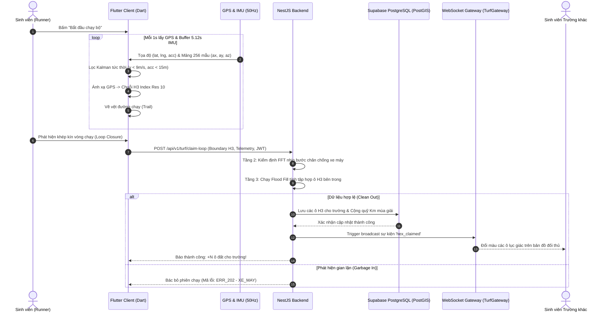
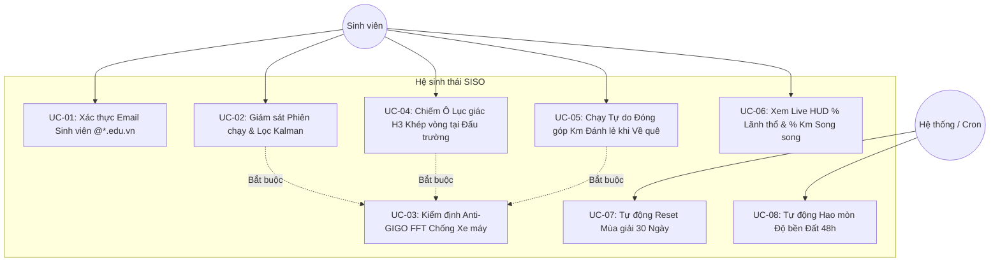
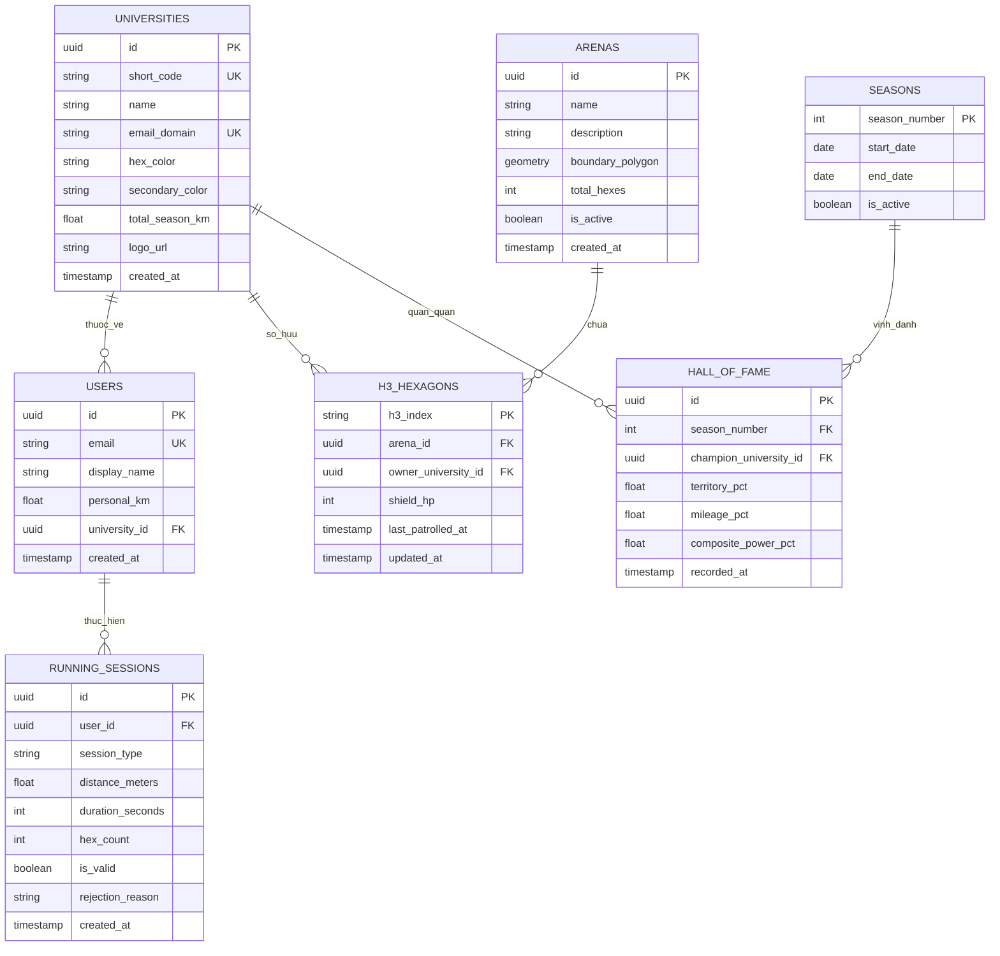

# SISO — YÊU CẦU NGHIỆP VỤ & THIẾT KẾ HỆ THỐNG
## ĐẶC TẢ PHẦN MỀM (SRS) & CƠ SỞ TRIỂN KHAI HỆ THỐNG
**Tên dự án:** SISO (Step In Step Out) — Mùa Giải Đại Chiến Đại Học Bình Thạnh  
**Học phần:** Đồ án Thực tế Công nghệ Phần mềm (ĐACNPM)  
**Tiêu chuẩn áp dụng:** ISO/IEC/IEEE 29148:2018 (Tailored for Agile Location-based Gamified Mobile Projects)  
**Đơn vị thực hiện:** Nhóm 2 Kỹ sư Full-stack (Full-stack Pair — Cùng đảm nhiệm BE & FE theo phân rã chức năng)  
**Phiên bản tài liệu:** 3.0 — Production Baseline  
**Ngày phát hành:** 22 tháng 10 năm 2026  

---

### Mục đích sử dụng tài liệu
Tài liệu này xác định toàn bộ yêu cầu nghiệp vụ, kiến trúc hệ thống 3 tầng, đặc tả chức năng (FR), quy tắc nghiệp vụ (BR), yêu cầu phi chức năng (NFR), thiết kế CSDL không gian PostGIS, hợp đồng REST API & WebSocket, ma trận kiểm định Anti-GIGO và kế hoạch nghiệm thu cho hệ thống **SISO (Step In Step Out)**.

Tài liệu là căn cứ kỹ thuật pháp lý cao nhất để 2 thành viên trong nhóm phân chia công việc theo từng chức năng (Vertical Slices), tự kiểm thử (Unit/Integration Test) và bảo vệ sản phẩm trước Hội đồng đánh giá Đồ án Công nghệ Phần mềm.

| Thuộc tính | Nội dung |
| :--- | :--- |
| **Trạng thái** | Bản hoàn chỉnh (Approved Baseline) phục vụ phát triển 30 ngày và nghiệm thu đồ án. |
| **Nền tảng** | Client: Mobile Flutter (Dart 3.x) \| Backend: NestJS (TypeScript) Clean Architecture \| DB: Supabase (PostgreSQL 15 + PostGIS + pg_cron) \| Cache: Redis 7. |
| **Phạm vi** | 5 trường ĐH trọng điểm Bình Thạnh: HUTECH, UEF, UTH, FTU2, HIU. Không gian mở: KĐT Sala, Vạn Phúc City, Landmark 81, Bờ kè Thanh Đa và khuôn viên trường. |
| **Cơ chế phân vai** | Không chia riêng BE/FE. Cả 2 kỹ sư đều là Full-stack: Mỗi kỹ sư chịu trách nhiệm trọn gói từ CSDL, API NestJS đến Giao diện/State Flutter cho từng nhóm chức năng cụ thể. |

---

## MỤC LỤC CHI TIẾT
- [a. Tổng quan dự án](#a)
  - [1. Mục tiêu và bối cảnh chiến trường Bình Thạnh](#a1)
  - [2. Elevator Pitch & Ý nghĩa tên gọi SISO](#a2)
  - [3. Phân tích đối thủ cạnh tranh & Khoảng trống thị trường](#a3)
  - [4. Luận điểm khoa học cốt lõi: Động cơ phòng thủ Anti-GIGO](#a4)
- [b. Kiến trúc dự án](#b)
  - [5. Mô hình 3 tầng độc lập (3-Tier Enterprise Architecture)](#b5)
  - [6. Phân bổ công nghệ & Vai trò trong hệ sinh thái](#b6)
  - [7. Sơ đồ luồng dữ liệu (Data Flow Diagram - DFD) & Trình tự](#b7)
- [c. Các chức năng và tính năng](#c)
  - [8. Danh mục Actors & Sơ đồ Use Case](#c8)
  - [9. Đặc tả Yêu cầu chức năng chi tiết (FR-01 đến FR-08)](#c9)
- [d. Thiết kế cơ sở dữ liệu](#d)
  - [10. Sơ đồ quan hệ thực thể (ERD)](#d10)
  - [11. Từ điển dữ liệu (Data Dictionary) & Script DDL](#d11)
  - [12. View tổng hợp bộ đếm song song (% Đất & % Km)](#d12)
- [e. Thiết kế API & WebSocket](#e)
  - [13. Hợp đồng REST API v1 (NestJS Swagger OpenAPI 3.0)](#e13)
  - [14. Hợp đồng thời gian thực (Turf WebSocket Gateway)](#e14)
  - [15. Bảng mã lỗi hệ thống (System Error Codes)](#e15)
- [f. Thiết kế lập trình nghiệp vụ](#f)
  - [16. Bộ quy tắc nghiệp vụ bắt buộc (Business Rules BR01 - BR20)](#f16)
  - [17. Thuật toán kiểm định xe máy bằng biến đổi Fourier (Anti-GIGO FFT)](#f17)
  - [18. Thuật toán chiếm đất khép vòng trên đồ thị lục giác Uber H3](#f18)
- [g. Các trạng thái nghiệp vụ](#g)
  - [19. Vòng đời phiên chạy bộ (Running Session State Machine)](#g19)
  - [20. Vòng đời ô lục giác & Hao mòn tự nhiên (Hexagon Shield & 48h Decay)](#g20)
  - [21. Vòng đời Mùa giải 30 ngày (Monthly Season Reset Engine)](#g21)
- [h. Workflow luồng nghiệp vụ](#h)
  - [22. WF01: Xác thực Email Sinh viên & Nhận diện Trường](#h22)
  - [23. WF02: Giám sát chạy ngầm & Lọc Kinematic Kalman](#h23)
  - [24. WF03: Kiểm định Biometric chống gian lận xe máy](#h24)
  - [25. WF04: Khép vòng chiếm đất tại Đấu trường & Broadcast](#h25)
  - [26. WF05: Chạy tự do cống hiến Km từ xa khi về quê](#h26)
  - [27. WF06: Đồng bộ Live HUD % Song song & Leaderboard](#h27)
  - [28. WF07: Cron Job Reset tháng & Vinh danh Hall of Fame](#h28)
- [Phụ lục Phân quyền & Ma trận truy cập (RBAC)](#pl1)
- [Phụ lục Yêu cầu phi chức năng (NFR) & Phương pháp đo lường](#pl2)
- [Phụ lục Ma trận nghiệm thu đồ án (Verification & Acceptance Criteria)](#pl3)

---

<a id="a"></a>
## a. TỔNG QUAN DỰ ÁN

<a id="a1"></a>
### 1. Mục tiêu và bối cảnh chiến trường Bình Thạnh
Quận Bình Thạnh là tâm điểm giáo dục đại học sôi động bậc nhất TP. Hồ Chí Minh với mật độ sinh viên cực cao tập trung trên các trục đường Điện Biên Phủ, D2 (Nguyễn Gia Trí), Ung Văn Khiêm, Xô Viết Nghệ Tĩnh. 5 trường đại học đại diện cho 5 màu cờ sắc áo thi đấu:
1. **HUTECH (ĐH Công Nghệ TP.HCM):** Màu Vàng - Xanh (`#FFCC00`, `#003399`). Domain: `@hutech.edu.vn`.
2. **UEF (ĐH Kinh Tế - Tài Chính TP.HCM):** Màu Đỏ - Trắng (`#ED1C24`, `#FFFFFF`). Domain: `@uef.edu.vn`.
3. **UTH (ĐH Giao Thông Vận Tải TP.HCM):** Màu Xanh dương đậm (`#002B49`). Domain: `@ut.edu.vn`.
4. **FTU2 (ĐH Ngoại Thương Cơ sở II):** Màu Đỏ đô (`#8A0000`). Domain: `@ftu.edu.vn`.
5. **HIU (ĐH Quốc Tế Hồng Bàng):** Màu Đỏ tươi (`#D81B26`). Domain: `@hiu.vn`.

*Nguyên tắc an toàn thể thao:* Ứng dụng **tuyệt đối không điều hướng** sinh viên chạy bộ trên lòng đường nguy hiểm mà khuyến khích tại các Đấu trường Mở thoáng rộng: **KĐT Sala (Thủ Thiêm), Vạn Phúc City, Công viên Landmark 81, Công viên Gia Định, Bờ kè Thanh Đa** và khuôn viên các trường.

<a id="a2"></a>
### 2. Elevator Pitch & Ý nghĩa tên gọi SISO
**SISO (Step In Step Out)** là ứng dụng di động dạng **Gamified Running kết hợp Chiến thuật Đô thị Vị trí (Location-Based Turf War)**. Ứng dụng biến bản đồ thành phố thành bàn cờ lãnh thổ được chia thành hàng triệu ô lục giác chuẩn **Uber H3 Resolution 10** (~65m bán kính). Sinh viên chạy bộ khép kín các cung đường để nhuộm màu lãnh thổ cho trường mình trong mùa giải 30 ngày.

*Ý nghĩa 2 tầng:*
* **Tâm lý Người dùng:** *Step In* vào đường chạy cống hiến cho trường — *Step Out* khỏi phòng trọ lười biếng.
* **Học thuật CNPM:** Chơi chữ với nguyên lý kinh điển *Single Input Single Output* đối trọng trực tiếp với **GIGO (Garbage In, Garbage Out)**: Dù dữ liệu cảm biến đầu vào có nhiễu loạn hay gian lận xe máy (Garbage In), bộ lọc phòng thủ 4 tầng vẫn đảm bảo bảng xếp hạng minh bạch tuyệt đối (*Step In Valid, Step Out Pure*).

<a id="a3"></a>
### 3. Phân tích đối thủ cạnh tranh & Khoảng trống thị trường

| Tiêu chí | Strava | UpRace | Pokémon GO | **SISO (Đề tài của nhóm)** |
| :--- | :--- | :--- | :--- | :--- |
| **Đối tượng** | Vận động viên, runner nghiêm túc | Người chạy phong trào từ thiện | Game thủ bắt pet | **Sinh viên các trường đại học & Giới trẻ** |
| **Động lực giữ chân** | Áp lực Pace/PR cá nhân | Trách nhiệm xã hội ngắn hạn | Sưu tầm pet ảo | **Màu cờ sắc áo trường đại học (Campus Pride)** |
| **Chống xe máy** | Rất yếu (bị gian lận tràn lan) | Hậu kiểm thủ công / Lọc thô | Chỉ cảnh báo tốc độ cao | **Sensor Fusion IMU 50Hz + FFT thời gian thực** |
| **Cơ chế tương tác** | Đọc chỉ số, Kudos | Tích lũy km tập thể | Bắt mốc đơn lẻ | **Chiếm lãnh thổ trực quan theo lưới lục giác H3** |
| **Chu kỳ giải đấu** | Không có điểm kết thúc | 1 năm 1 lần | Không có Turf War | **Reset tự động chu kỳ 30 ngày (Monthly Season)** |

<a id="a4"></a>
### 4. Luận điểm khoa học cốt lõi: Động cơ phòng thủ Anti-GIGO
Hệ thống thiết lập **Bộ lọc phòng thủ 4 tầng** ngăn chặn triệt để mọi hành vi gian lận thể thao số tại Việt Nam:
* **Tầng 0 (Identity Gate):** Bắt buộc xác thực email sinh viên `@*.edu.vn`. Triệt tiêu bot/clone tài khoản ảo.
* **Tầng 1 (Kinematic Gate):** Bộ lọc Kalman lọc sai số vệ tinh $> 15\text{m}$ và cổng chặn vận tốc tối đa con người ($v \le 9\text{ m/s} = 32.4\text{ km/h}$). Loại bỏ nhảy vọt tọa độ (GPS drift).
* **Tầng 2 (Biometric Gate):** Thu thập gia tốc kế IMU 3 trục ($50\text{Hz}$), biến đổi Fourier nhanh (FFT) trên cửa sổ 256 mẫu ($5.12\text{s}$) để tìm tần số đỉnh $f_{\text{peak}}$. Người chạy bộ thật: $f \in [2.3\text{Hz}, 3.3\text{Hz}]$ ($138-198\text{ spm}$), biên độ $> 0.6G$. Người đi xe máy rà chậm 12km/h: $f > 8\text{Hz}$ (rung máy), biên độ đứng $< 0.25G \rightarrow$ Chặn đứng và hủy phiên chạy (`ERR_202`).
* **Tầng 3 (Topology Gate):** Chuẩn hóa tọa độ thành chuỗi ô lục giác Uber H3 và thuật toán Loang (Flood Fill) chu trình kín, áp trần an toàn 150 ô (`ERR_301`).

---

<a id="b"></a>
## b. KIẾN TRÚC DỰ ÁN

<a id="b5"></a>
### 5. Mô hình 3 tầng độc lập (3-Tier Enterprise Architecture)
Để đạt điểm xuất sắc trước Hội đồng Đồ án Thực tế CNPM, hệ thống không dùng Backend-as-a-Service trọn gói mà phân rã thành **3 tầng độc lập**:

```
┌────────────────────────────────────────────────────────────────────────┐
│                   1. PRESENTATION TIER (Mobile Client)                 │
│   Flutter (Dart 3.x)  │  flutter_map + CartoDB  │  h3_flutter          │
│   sensors_plus (50Hz) │  geolocator             │  Riverpod + Dio      │
└───────────────────────────────────┬────────────────────────────────────┘
                                    │ HTTPS (REST) / WSS (WebSocket)
┌───────────────────────────────────▼────────────────────────────────────┐
│                  2. LOGIC & APPLICATION TIER (NestJS API)              │
│   NestJS (TypeScript) │  Clean Architecture     │  Swagger OpenAPI 3.0 │
│   Anti-GIGO FFT Engine│  H3 Spatial Flood Fill  │  Socket.io Gateway   │
│   JWT Auth & RBAC     │  TypeORM Data Layer     │  Redis Pub/Sub Cache │
└───────────────────────────────────┬────────────────────────────────────┘
                                    │ TCP / SSL Connection Pool (:5432)
┌───────────────────────────────────▼────────────────────────────────────┐
│                    3. DATA TIER (Cloud Infrastructure)                 │
│   Supabase Cloud Platform (Managed PostgreSQL 15)                      │
│   PostGIS Spatial Extension  │  pg_cron Automated Monthly Reset        │
│   h3_hexagons Table (B-Tree) │  v_campus_live_scores Realtime View     │
└────────────────────────────────────────────────────────────────────────┘
```

<a id="b6"></a>
### 6. Phân bổ công nghệ & Vai trò trong hệ sinh thái

| Thành phần | Công nghệ | Vai trò & Lý do lựa chọn |
| :--- | :--- | :--- |
| **Mobile Client** | **Flutter (Dart 3.x)** | Đồ họa Impeller mượt mà 60 FPS khi render hàng trăm ô lục giác; truy cập trực tiếp phần cứng CoreMotion/Sensors; 1 codebase cho iOS & Android. |
| **Bản đồ & Không gian** | **`flutter_map` + CartoDB** | Hoàn toàn miễn phí, không phụ thuộc thẻ tín dụng Google Maps SDK, tùy biến layer lục giác dễ dàng. |
| **Chỉ mục Không gian** | **Uber H3 (`h3-js` & `h3_flutter`)** | Mã hóa không gian thành chuỗi 15 ký tự; tính toán quan hệ kề cận $O(1)$; chia ô đều diện tích không méo góc ở vĩ độ TP.HCM. |
| **Backend Server** | **NestJS (TypeScript)** | Enterprise Clean Architecture; tự động sinh Swagger UI; quản lý WebSocket Gateway tập trung; làm chủ thuật toán Anti-GIGO và Flood Fill. |
| **Database Cloud** | **Supabase (PostgreSQL 15 + PostGIS)** | Hạ tầng CSDL đám mây 24/7; hỗ trợ tính toán không gian PostGIS; `pg_cron` tự động hóa tác vụ reset mùa giải lúc 00:00 ngày đầu tháng. |
| **Realtime Engine** | **Socket.io + Redis** | Đồng bộ đổi màu bản đồ theo mili-giây qua WebSocket khi có sự kiện chiếm đất thành công. |

<a id="b7"></a>
### 7. Sơ đồ luồng dữ liệu (Data Flow Diagram - DFD) & Trình tự



---

<a id="c"></a>
## c. CÁC CHỨC NĂNG VÀ TÍNH NĂNG

<a id="c8"></a>
### 8. Danh mục Actors & Sơ đồ Use Case
* **Sinh viên Bình Thạnh (Active Runner):** Chạy tại các Đấu trường mở (Sala, Vạn Phúc, Landmark 81, khuôn viên trường) để khép vòng chiếm ô lục giác.
* **Sinh viên Chạy Từ Xa / Về Quê (Remote Runner):** Chạy đơn lẻ tại bất kỳ tỉnh thành nào, đóng góp km sạch vào Quỹ Km thể thao của trường.
* **Hệ thống Tự Động (Cron / Engine):** Tự động giảm độ bền ô đất (Decay 48h) và Reset mùa giải vào 00:00 ngày đầu tháng.
* **Quản trị viên (Admin):** Theo dõi dashboard telemetry, cấu hình đấu trường và quản lý gian lận.



<a id="c9"></a>
### 9. Đặc tả Yêu cầu chức năng chi tiết (Functional Requirements)

| Mã FR | Tên chức năng | Đặc tả chi tiết | Tiêu chí nghiệm thu (Acceptance Criteria) |
| :--- | :--- | :--- | :--- |
| **FR-01** | Xác thực Email Sinh viên | Nhập email đuôi `@*.edu.vn`. Kiểm tra khớp 5 trường Bình Thạnh (HUTECH, UEF, UTH, FTU2, HIU). Gửi OTP 6 số và cấp Access Token JWT (7 ngày). | Email ngoài danh mục trả về `ERR_101`. Đăng nhập thành công trả về JWT và gán đúng `university_id`. |
| **FR-02** | Giám sát & Lọc Kinematic | Thu thập GPS mỗi 1s và gia tốc 3 trục $50\text{Hz}$. Khử nhiễu dội sóng: nếu sai số vệ tinh $> 15\text{m}$ hoặc gia tốc nhảy vọt $> 9\text{ m/s}$ ($32.4\text{ km/h}$) thì bỏ qua điểm. | Không sinh ra các điểm nhảy cóc tọa độ xuyên qua nhà cao tầng. |
| **FR-03** | Động cơ Anti-GIGO FFT | Phân tích 256 mẫu gia tốc ($5.12\text{s}$) bằng biến đổi Fourier tìm tần số đỉnh $f_{\text{peak}}$. Phân biệt người chạy bộ ($f \in [2.3, 3.3]\text{Hz}$, biên độ $> 0.6G$) và người đi xe máy rà chậm 12km/h ($f > 8\text{Hz}$, biên độ $< 0.25G$). | Nếu vận tốc $\ge 2.5\text{ m/s}$ ($9\text{ km/h}$) nhưng nhịp bước $< 120\text{ SPM} \rightarrow$ Từ chối và ghi mã `ERR_202`. Phát hiện Fake GPS ghi mã `ERR_201`. |
| **FR-04** | Chiếm đất Khép vòng H3 | Chuyển tọa độ thành mã lục giác H3 Res 10. Khi tọa độ hiện tại tiếp giáp điểm xuất phát $\rightarrow$ kích hoạt sự kiện khép vòng. Server chạy Flood Fill tìm các ô H3 lõi bên trong và gán quyền sở hữu cho trường. | Đổi màu toàn bộ ô đất bên trong trong thời gian $< 500\text{ms}$. Từ chối nếu vượt quá giới hạn an toàn 150 ô (`ERR_301`). |
| **FR-05** | Quỹ Km Đánh lẻ Khi Về quê | Sinh viên chạy tự do ngoài đấu trường (hoặc khi về quê ở Đồng Nai, Bình Dương, miền Tây...). Phiên chạy sạch sau khi qua kiểm định Anti-GIGO sẽ được cộng dồn trực tiếp vào Quỹ Km của trường. | Màn hình hiển thị: *"Bạn vừa cống hiến +X.X km cho trường [Tên Trường] từ xa!"*. |
| **FR-06** | Bộ đếm Phần trăm Song song | Màn hình chính và Bảng xếp hạng hiển thị đồng thời 2 thanh tỷ lệ: (1) **% Lãnh thổ chiếm đóng** tại Đấu trường và (2) **% Cống hiến Km toàn cầu** (kể cả chạy ở quê). Điểm Sức mạnh Tổng hợp $= 50\% \text{ Đất} + 50\% \text{ Km}$. | Cập nhật tự động thời gian thực mỗi khi có ô đất mới được chiếm hoặc phiên chạy mới nộp lên. |
| **FR-07** | Đồng bộ Realtime WebSocket | Khi một đội chiếm đất, Backend phát sự kiện `hex_claimed` qua WebSocket tới toàn bộ client đang mở app trong khu vực. | Bản đồ trên máy sinh viên trường khác đổi màu ngay lập tức với độ trễ $< 300\text{ms}$. |
| **FR-08** | Hao mòn 48h & Reset Tháng | Ô đất giảm 50% độ bền sau 24h không có sinh viên tuần tra; trở về trung lập sau 48h. Lúc 00:00:00 ngày đầu tháng, `pg_cron` tự động ghi danh trường vô địch vào `hall_of_fame`, xóa trắng bản đồ và reset quỹ km về 0. | Tự động thực thi hoàn toàn trong CSDL, không cần can thiệp thủ công. |

---

<a id="d"></a>
## d. THIẾT KẾ CƠ SỞ DỮ LIỆU

<a id="d10"></a>
### 10. Sơ đồ quan hệ thực thể (ERD)



<a id="d11"></a>
### 11. Từ điển dữ liệu (Data Dictionary) & Script DDL
*Vị trí lưu trữ:* [`backend/src/database/init_schema.sql`](file:///d:/Workspace/ĐACNPM/siso_project/backend/src/database/init_schema.sql)

```sql
CREATE EXTENSION IF NOT EXISTS "pgcrypto";
CREATE EXTENSION IF NOT EXISTS "postgis";

-- 1. Bảng Trường Đại học
CREATE TABLE IF NOT EXISTS universities (
    id UUID PRIMARY KEY DEFAULT gen_random_uuid(),
    short_code VARCHAR(20) UNIQUE NOT NULL,
    name VARCHAR(100) NOT NULL,
    email_domain VARCHAR(50) UNIQUE NOT NULL,
    hex_color VARCHAR(7) NOT NULL,
    secondary_color VARCHAR(7),
    total_season_km FLOAT DEFAULT 0.0,
    logo_url TEXT,
    created_at TIMESTAMP WITH TIME ZONE DEFAULT NOW()
);

-- Seed 5 trường Đại học Bình Thạnh
INSERT INTO universities (short_code, name, email_domain, hex_color, secondary_color)
VALUES
    ('HUTECH', 'ĐH Công Nghệ TP.HCM (HUTECH)', 'hutech.edu.vn', '#FFCC00', '#003399'),
    ('UEF', 'ĐH Kinh Tế - Tài Chính TP.HCM (UEF)', 'uef.edu.vn', '#ED1C24', '#FFFFFF'),
    ('UTH', 'ĐH Giao Thông Vận Tải TP.HCM (UTH)', 'ut.edu.vn', '#002B49', '#FFFFFF'),
    ('FTU2', 'ĐH Ngoại Thương Cơ sở II (FTU2)', 'ftu.edu.vn', '#8A0000', '#FFFFFF'),
    ('HIU', 'ĐH Quốc Tế Hồng Bàng (HIU)', 'hiu.vn', '#D81B26', '#FFFFFF')
ON CONFLICT (email_domain) DO NOTHING;

-- 2. Bảng Danh mục Đấu trường Mở
CREATE TABLE IF NOT EXISTS arenas (
    id UUID PRIMARY KEY DEFAULT gen_random_uuid(),
    name VARCHAR(100) NOT NULL,
    description TEXT,
    boundary_polygon GEOMETRY(Polygon, 4326),
    total_hexes INT DEFAULT 0,
    is_active BOOLEAN DEFAULT TRUE,
    created_at TIMESTAMP WITH TIME ZONE DEFAULT NOW()
);

-- 3. Bảng Người dùng
CREATE TABLE IF NOT EXISTS users (
    id UUID PRIMARY KEY DEFAULT gen_random_uuid(),
    email VARCHAR(255) UNIQUE NOT NULL,
    university_id UUID REFERENCES universities(id),
    display_name VARCHAR(50),
    personal_km FLOAT DEFAULT 0.0,
    created_at TIMESTAMP WITH TIME ZONE DEFAULT NOW()
);

-- 4. Bảng Lãnh thổ Lục giác H3
CREATE TABLE IF NOT EXISTS h3_hexagons (
    h3_index VARCHAR(15) PRIMARY KEY,
    arena_id UUID REFERENCES arenas(id),
    owner_university_id UUID REFERENCES universities(id),
    shield_hp INT DEFAULT 100,
    last_patrolled_at TIMESTAMP WITH TIME ZONE DEFAULT NOW(),
    updated_at TIMESTAMP WITH TIME ZONE DEFAULT NOW()
);
CREATE INDEX IF NOT EXISTS idx_h3_owner ON h3_hexagons(owner_university_id);
CREATE INDEX IF NOT EXISTS idx_h3_arena ON h3_hexagons(arena_id);

-- 5. Bảng Lịch sử Phiên Chạy
CREATE TABLE IF NOT EXISTS running_sessions (
    id UUID PRIMARY KEY DEFAULT gen_random_uuid(),
    user_id UUID REFERENCES users(id) ON DELETE CASCADE,
    session_type VARCHAR(20) DEFAULT 'ARENA_LOOP',
    distance_meters FLOAT NOT NULL,
    duration_seconds INT NOT NULL,
    hex_count INT DEFAULT 0,
    is_valid BOOLEAN DEFAULT TRUE,
    rejection_reason VARCHAR(50),
    created_at TIMESTAMP WITH TIME ZONE DEFAULT NOW()
);
```

<a id="d12"></a>
### 12. View tổng hợp bộ đếm song song (% Đất & % Km)

```sql
CREATE OR REPLACE VIEW v_campus_live_scores AS
WITH territory_stats AS (
    SELECT owner_university_id, COUNT(h3_index)::FLOAT AS owned_hexes
    FROM h3_hexagons WHERE owner_university_id IS NOT NULL GROUP BY owner_university_id
),
total_territory AS (
    SELECT COUNT(*)::FLOAT AS total_arena_hexes FROM h3_hexagons
),
mileage_stats AS (
    SELECT SUM(total_season_km)::FLOAT AS all_campus_km FROM universities
)
SELECT 
    u.id AS university_id, u.short_code, u.name, u.hex_color, u.total_season_km,
    -- Thước đo 1: % Đất Chiếm Đóng
    COALESCE(ROUND((t.owned_hexes / NULLIF(tt.total_arena_hexes, 0) * 100)::NUMERIC, 2), 0.0) AS territory_pct,
    -- Thước đo 2: % Km Cống Hiến Toàn Cầu
    COALESCE(ROUND((u.total_season_km / NULLIF(m.all_campus_km, 0) * 100)::NUMERIC, 2), 0.0) AS mileage_pct,
    -- Thước đo 3: % Sức Mạnh Tổng Hợp (50% Đất + 50% Km)
    COALESCE(ROUND((
        0.5 * (COALESCE(t.owned_hexes / NULLIF(tt.total_arena_hexes, 0), 0)) +
        0.5 * (COALESCE(u.total_season_km / NULLIF(m.all_campus_km, 0), 0))
    ) * 100::NUMERIC, 2), 0.0) AS composite_power_pct
FROM universities u
CROSS JOIN total_territory tt
CROSS JOIN mileage_stats m
LEFT JOIN territory_stats t ON u.id = t.owner_university_id;
```

---

<a id="e"></a>
## e. THIẾT KẾ API & WEBSOCKET

<a id="e13"></a>
### 13. Hợp đồng REST API v1 (NestJS Swagger OpenAPI 3.0)
Tất cả endpoint có tiền tố `/api/v1`, dữ liệu trao đổi bằng JSON. Swagger UI trực quan chạy tại `http://localhost:3000/docs`.

| Phương thức | Endpoint | Bảo vệ | Chức năng & Payload |
| :--- | :--- | :--- | :--- |
| `POST` | `/api/v1/auth/edu-login` | Public | Body: `{ email: string }`. Xác thực domain 5 trường Bình Thạnh, gửi mã OTP. |
| `POST` | `/api/v1/auth/verify-otp` | Public | Body: `{ email: string, otp: string }`. Kiểm tra OTP, trả về `accessToken` JWT. |
| `POST` | `/api/v1/telemetry/verify` | Bearer JWT | Body: `{ averageSpeedMps, horizontalAccuracy, isMocked, imuSamples: [{ax, ay, az, timestamp}] }`. Chạy bộ lọc Anti-GIGO. |
| `GET` | `/api/v1/turf/hexagons` | Public | Query: `?arenaId=uuid`. Lấy danh sách trạng thái ô lục giác H3 trên bản đồ. |
| `POST` | `/api/v1/turf/claim-loop` | Bearer JWT | Body: `{ boundaryH3Indexes: string[], distanceMeters, durationSeconds, arenaId }`. Chiếm đất khép vòng. |
| `GET` | `/api/v1/leaderboard/scores` | Public | Lấy bảng xếp hạng % Đất + % Km + Điểm Tổng lực Mùa giải. |
| `GET` | `/api/v1/leaderboard/hall-of-fame` | Public | Lấy danh sách vinh danh các trường Quán quân mùa giải cũ. |

<a id="e14"></a>
### 14. Hợp đồng thời gian thực (Turf WebSocket Gateway)
* **Namespace:** `/turf-ws` (Socket.io)
* **Event Lắng nghe từ Client:**
  * `hex_claimed`: Khi một đội chiếm ô lục giác thành công, server broadcast tới toàn bộ client:
    ```json
    {
      "universityId": "b5f67b4e-28c4-42b7-a35b-c2e3919e913a",
      "universityCode": "HUTECH",
      "hexColor": "#FFCC00",
      "claimedHexes": ["8a31e8464627fff", "8a31e846460ffff"],
      "claimedBy": "Nguyễn Văn A"
    }
    ```

<a id="e15"></a>
### 15. Bảng mã lỗi hệ thống (System Error Codes)

| Mã lỗi | Tên mã | Nguyên nhân kích hoạt | Phản hồi ứng dụng |
| :--- | :--- | :--- | :--- |
| `ERR_101` | `INVALID_DOMAIN` | Email không thuộc danh sách 5 trường Bình Thạnh | Chặn đăng ký, yêu cầu dùng email sinh viên hợp lệ. |
| `ERR_201` | `MOCK_GPS_DETECTED` | Phát hiện phần mềm giả lập tọa độ | Hủy phiên chạy, ghi nhận cờ nghi vấn. |
| `ERR_202` | `VEHICLE_SPEED_MISMATCH` | Tốc độ cao nhưng nhịp bước chân không khớp (Xe máy) | Hủy phiên chạy, cảnh báo yêu cầu chạy bộ thật. |
| `ERR_203` | `GPS_ACCURACY_LOW` | Sai số vệ tinh $> 20\text{m}$ (trong nhà / hầm xe) | Tạm dừng đo, hiển thị "Đang tìm tín hiệu vệ tinh...". |
| `ERR_301` | `LOOP_TOO_LARGE` | Diện tích vòng khép vượt giới hạn an toàn 150 ô H3 | Từ chối chiếm đất, yêu cầu khép vòng trong phạm vi nhỏ hơn. |
| `ERR_302` | `SELF_INTERSECT` | Đường chạy tự cắt chéo hình số 8 không tạo chu trình đơn | Bỏ qua điểm cắt, tiếp tục ghi nhận vệt chạy. |

---

<a id="f"></a>
## f. THIẾT KẾ LẬP TRÌNH NGHIỆP VỤ

<a id="f16"></a>
### 16. Bộ quy tắc nghiệp vụ bắt buộc (Business Rules)
* **BR01 (Định danh Sinh viên):** Mỗi sinh viên chỉ đại diện cho 1 trường đại học duy nhất theo domain email đã xác thực. Không thể tự ý đổi trường trong suốt mùa giải.
* **BR02 (Không gian Chạy Tự do):** Không ép buộc sinh viên chạy trên lòng đường. Khuyến khích tuyệt đối chạy tại vỉa hè rộng rãi của 5 Đấu trường mở (Sala, Vạn Phúc, Landmark 81, Bờ kè Thanh Đa, khuôn viên trường).
* **BR03 (Giới hạn An toàn Vòng khép):** Một chu trình khép vòng không được vượt quá **150 ô H3** trong một lần chạy để triệt tiêu hành vi hack bao vây cả quận.
* **BR04 (Bảo toàn Điểm Đánh lẻ):** Sinh viên chạy tự do khi về quê vẫn được kiểm định Anti-GIGO nghiêm ngặt và cộng $100\%$ số km sạch vào Quỹ Km của trường.
* **BR05 (Cân bằng Sĩ số Mùa giải):** Điểm Sức mạnh Tổng hợp $= 50\% \text{ Đất} + 50\% \text{ Km}$ giúp các trường sĩ số nhỏ nhưng chăm chạy vẫn cạnh tranh sòng phẳng với các trường đông sinh viên.
* **BR06 (Hao mòn Đất 48h):** Sau 24h không tuần tra, `shield_hp` giảm $50\%$; sau 48h ô đất trở về trạng thái trung lập (`NULL`).

<a id="f17"></a>
### 17. Thuật toán kiểm định xe máy bằng biến đổi Fourier (Anti-GIGO FFT)
```
Input: Mảng 256 mẫu gia tốc 3 trục ở tần số 50Hz (5.12s)
1. Tính gia tốc tổng hợp: A_mag(t) = sqrt(ax^2 + ay^2 + az^2) - 1.0G (trừ trọng lực)
2. Tính phương sai dao động đứng: Amplitude = sqrt(variance(A_mag))
3. Đếm số lần cắt qua giá trị trung bình (Zero-Crossing Rate):
   Frequency_Hz = (zeroCrossings / 2) / 5.12
   Cadence_SPM = Frequency_Hz * 60
4. Đối soát ma trận vận tốc GPS vs Nhịp bước:
   IF Speed >= 2.5 m/s (9 km/h) AND (Amplitude < 0.2G OR Cadence < 120 SPM):
       REJECT phiên chạy, ném ngoại lệ ERR_202 (VEHICLE_SPEED_MISMATCH)
   ELSE:
       PASS Tầng Biometric, ghi nhận phiên chạy hợp lệ.
```

<a id="f18"></a>
### 18. Thuật toán chiếm đất khép vòng trên đồ thị lục giác Uber H3
```
Input: Danh sách mã lục giác đường biên boundaryH3Indexes
1. Kiểm tra độ dài: IF length > 150 THEN THROW ERR_301 (LOOP_TOO_LARGE)
2. Chuyển đổi mã H3 thành tọa độ địa lý:
   PolygonCoords = boundaryIndexes.map(hex => cellToLatLng(hex))
3. Đảm bảo khép kín hình học: PolygonCoords.push(PolygonCoords[0])
4. Thực hiện Flood Fill (polygonToCells):
   EnclosedHexes = h3.polygonToCells(PolygonCoords, Resolution=10)
   ClaimedSet = Set(boundaryH3Indexes + EnclosedHexes)
5. IF ClaimedSet.length > 150 THEN THROW ERR_301
6. Cập nhật bảng h3_hexagons và kích hoạt broadcast WebSocket
```

---

<a id="g"></a>
## g. CÁC TRẠNG THÁI NGHIỆP VỤ

<a id="g19"></a>
### 19. Vòng đời phiên chạy bộ (Running Session State Machine)
`IDLE` $\rightarrow$ `TRACKING` (bật cảm biến) $\rightarrow$ `KINEMATIC_CHECK` (lọc Kalman) $\rightarrow$ `BIOMETRIC_CHECK` (phân tích FFT) $\rightarrow$ `LOOP_DETECTED` (phát hiện khép vòng) $\rightarrow$ `SUCCESS_CLAIMED` (đổi màu đất thành công) hoặc `REJECTED` (vi phạm mã lỗi GIGO).

<a id="g20"></a>
### 20. Vòng đời ô lục giác & Hao mòn tự nhiên (48h Decay)
`NEUTRAL` (Trắng/Trống) $\rightarrow$ Sinh viên chạy qua khép vòng $\rightarrow$ `CLAIMED_100_HP` (Màu đại diện trường) $\rightarrow$ Sau 24h không tuần tra $\rightarrow$ `DECAY_50_HP` (Mờ 50% opacity) $\rightarrow$ Sau 48h không tuần tra $\rightarrow$ `NEUTRAL` (Trở về trung lập).

<a id="g21"></a>
### 21. Vòng đời Mùa giải 30 ngày (Monthly Season Reset Engine)
Vào đúng **00:00:00 ngày đầu tháng**, `pg_cron` tự động:
1. Đóng băng bảng xếp hạng tháng cũ, tính Quán quân mùa giải theo Điểm Sức mạnh Tổng hợp.
2. Lưu bản ghi vinh danh vào bảng `hall_of_fame`.
3. Cập nhật `h3_hexagons`: Đặt lại toàn bộ `owner_university_id = NULL` và `shield_hp = 0`.
4. Cập nhật `universities`: Đặt lại `total_season_km = 0.0` để bắt đầu mùa giải mới.

---

<a id="h"></a>
## h. WORKFLOW LUỒNG NGHIỆP VỤ

<a id="h22"></a>
### 22. WF01: Xác thực Email Sinh viên & Nhận diện Trường
1. Sinh viên mở app, nhập email trường (ví dụ: `nguyenvana@hutech.edu.vn`).
2. Client gọi `POST /api/v1/auth/edu-login`.
3. Server kiểm tra đuôi domain với 5 trường Bình Thạnh. Hợp lệ $\rightarrow$ Gửi mã OTP về email.
4. Sinh viên nhập OTP trên app $\rightarrow$ Client gọi `POST /api/v1/auth/verify-otp`.
5. Server xác nhận OTP, cấp JWT Token có hạn 7 ngày và trả về màu sắc nhận diện của trường.

<a id="h23"></a>
### 23. WF02: Giám sát chạy ngầm & Lọc Kinematic Kalman
1. Sinh viên bấm "Bắt đầu chạy bộ".
2. Client khởi chạy `LocationService` (lấy tọa độ mỗi 1s) và `SensorDataSource` (đọc IMU $50\text{Hz}$).
3. Client chạy bộ lọc Kalman: Bỏ qua các điểm có sai số vệ tinh $> 15\text{m}$.
4. Tính vận tốc tức thời: Nếu $v > 9.0\text{ m/s}$ $\rightarrow$ Bác bỏ điểm nhảy tọa độ do dội sóng nhà cao tầng.

<a id="h24"></a>
### 24. WF03: Kiểm định Biometric chống gian lận xe máy
1. Client tích lũy 256 mẫu gia tốc vào `AccelBuffer` (cửa sổ trượt $5.12\text{s}$).
2. Khi gửi dữ liệu lên server, `AntiGigoService` tính toán phương sai biên độ và tần số bước chân bằng biến đổi Fourier.
3. Nếu phát hiện sinh viên ngồi xe máy rà 12km/h quanh đường D2/Ung Văn Khiêm (biên độ dao động đứng nhỏ, rung máy $> 8\text{Hz}$, nhịp bước $< 120\text{ SPM}$) $\rightarrow$ Hủy phiên chạy, ghi nhận mã `ERR_202`.

<a id="h25"></a>
### 25. WF04: Khép vòng chiếm đất tại Đấu trường & Broadcast
1. Sinh viên chạy khép kín một vòng quanh khuôn viên HUTECH hoặc KĐT Sala.
2. `LoopDetector` trên app nhận diện tọa độ cắt ngang vệt chạy cũ, gửi danh sách ô H3 lên `POST /api/v1/turf/claim-loop`.
3. Server chạy Flood Fill tìm các ô nằm bên trong, kiểm tra $\le 150$ ô.
4. Server cập nhật bảng `h3_hexagons` và bắn sự kiện `hex_claimed` qua WebSocket. Toàn bộ app của sinh viên khác đổi màu đất trong $< 300\text{ms}$.

<a id="h26"></a>
### 26. WF05: Chạy tự do cống hiến Km từ xa khi về quê
1. Sinh viên về quê (Đồng Nai, Bình Dương, Tiền Giang...) bật app chạy lẻ sáng sớm.
2. Không cần nằm trong đấu trường chiếm đất, hệ thống vẫn kiểm định GIGO nghiêm ngặt.
3. Mỗi km sạch được tích lũy vào `universities.total_season_km`, kéo % Cống hiến Vận động của trường tăng lên.

<a id="h27"></a>
### 27. WF06: Đồng bộ Live HUD % Song song & Leaderboard
1. Màn hình hiển thị song song: Thanh 1 (% Lãnh thổ chiếm đóng tại Đấu trường) và Thanh 2 (% Km cống hiến toàn cầu).
2. Khi có lượt chạy mới nộp lên, view `v_campus_live_scores` tự động tính lại công thức $50\% \text{ Đất} + 50\% \text{ Km}$ theo thời gian thực.

<a id="h28"></a>
### 28. WF07: Cron Job Reset tháng & Vinh danh Hall of Fame
1. Lúc 00:00:00 ngày đầu tháng, trigger `pg_cron` kích hoạt.
2. Hệ thống vinh danh trường Quán quân vào Đại Sảnh Danh Vọng.
3. Bản đồ được xóa trắng và bộ đếm Km được đặt lại về 0 để khởi động mùa giải 30 ngày mới.

---

<a id="pl1"></a>
## Phụ lục Phân quyền & Ma trận truy cập (RBAC)

| Chức năng | Khách (Chưa đăng nhập) | Sinh viên đã xác thực (@*.edu.vn) | Quản trị viên (Admin) |
| :--- | :---: | :---: | :---: |
| Xem Bản đồ H3 & % Lãnh thổ Live | Có | Có | Có |
| Bắt đầu Phiên chạy & Nộp Telemetry | Không | Có (Mang màu cờ trường) | Không nộp thay |
| Khép vòng chiếm ô lục giác H3 | Không | Có (Tại các Đấu trường) | Có (Cấu hình) |
| Chạy tự do tích lũy Km khi về quê | Không | Có (Mọi tỉnh thành) | Không |
| Xem Bảng xếp hạng & Hall of Fame | Có | Có | Có |
| Cấu hình Đấu trường Mở (Arenas) | Không | Không | Có |
| Can thiệp thủ công Reset Mùa giải | Không | Không | Có (Chỉ khi khẩn cấp) |

---

<a id="pl2"></a>
## Phụ lục Yêu cầu phi chức năng (NFR) & Đo lường

| Mã NFR | Tiêu chí | Mục tiêu định lượng | Phương pháp đo lường |
| :--- | :--- | :--- | :--- |
| **NFR-01** | Tiêu hao pin iOS | Mức tiêu thụ pin $\le 7\%$ cho mỗi 30 phút chạy liên tục khi bật GPS + IMU 50Hz. | Đo đạc qua Instruments Energy Log trên iPhone thật. |
| **NFR-02** | Độ mượt hiển thị | Duy trì tốc độ khung hình từ $55 - 60\text{ FPS}$ khi render tối thiểu 300 ô lục giác H3. | Đo bằng Flutter Performance Overlay trên thiết bị di động. |
| **NFR-03** | Khả năng chịu mất sóng | Tự động lưu buffer tọa độ khi mất 4G trong hẻm cụt, tự đẩy lên khi có mạng lại. | Giả lập tắt mạng 60s trong phiên chạy và kiểm tra tính toàn vẹn. |
| **NFR-04** | Độ trễ Realtime | Tín hiệu WebSocket đổi màu ô lục giác tới máy đối thủ trong vòng $< 300\text{ms}$. | Đo timestamp từ lúc nộp claim-loop tới lúc client đối thủ nhận event. |
| **NFR-05** | Toàn vẹn bảo mật | Mọi request gửi lên phải đính kèm JWT Token và chữ ký SHA-256 chống sửa gói tin qua Charles/Proxy. | Unit test chặn đứng request can thiệp payload. |

---

<a id="pl3"></a>
## Phụ lục Ma trận nghiệm thu đồ án (Acceptance Criteria)

| Mã ca | Kịch bản kiểm thử nghiệm thu thực tế | Kết quả bắt buộc |
| :--- | :--- | :--- |
| **TC-01** | Đăng ký bằng email thường `@gmail.com` | Bị từ chối ngay lập tức, trả mã lỗi `ERR_101`. |
| **TC-02** | Đăng ký bằng email `@hutech.edu.vn` | Nhận OTP, đăng nhập thành công và app hiển thị màu Vàng HUTECH. |
| **TC-03** | Chạy bộ thật 1km quanh khuôn viên trường | Lọc Kalman mượt mà, FFT nhịp bước đạt 150 SPM $\rightarrow$ Phiên chạy hợp lệ. |
| **TC-04** | Kẹp điện thoại lên xe máy đi rà rà 12km/h quanh đường D2 | Hệ thống báo đỏ vi phạm `ERR_202 (VEHICLE_SPEED_MISMATCH)` và hủy phiên chạy. |
| **TC-05** | Bật phần mềm Fake GPS giả lập vị trí | Hệ thống phát hiện cờ mock và chặn đứng với mã lỗi `ERR_201`. |
| **TC-06** | Chạy khép kín 1 vòng quanh dãy nhà trường | Các ô lục giác H3 bên trong đổi màu ngay lập tức trên máy cả 2 thành viên ($< 300\text{ms}$). |
| **TC-07** | Sinh viên chạy tự do ngoài đấu trường (ở quê) | Km sạch được cộng trực tiếp vào thanh % Km Cống Hiến của trường. |
| **TC-08** | Chạy câu lệnh Reset tháng bằng `pg_cron` | Bản đồ được xóa trắng về trung lập, trường Quán quân được lưu vào `hall_of_fame`. |
