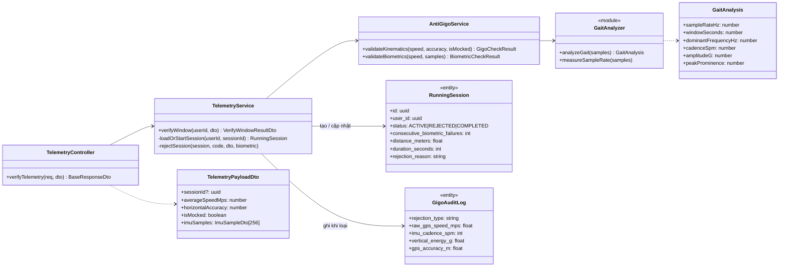
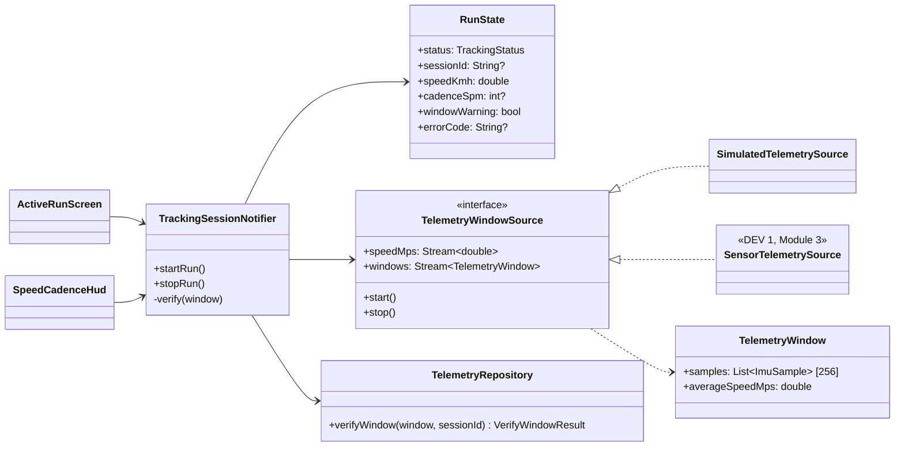
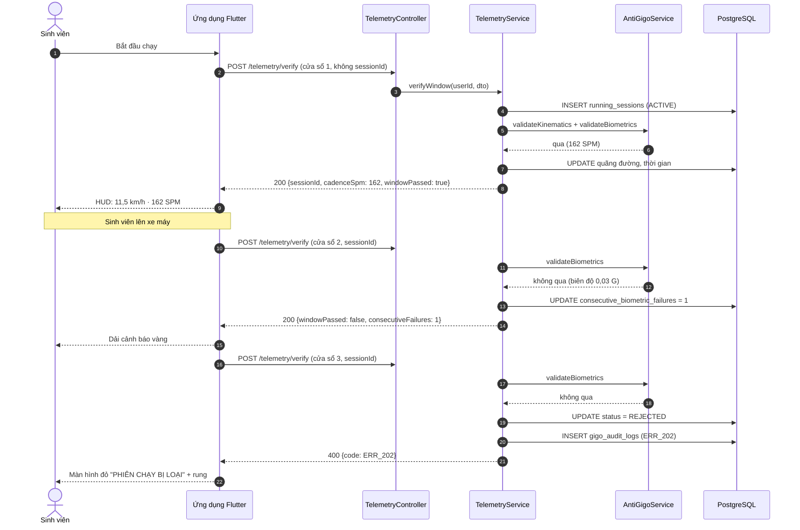

# Bản nháp báo cáo: Module 4, Cổng Sinh trắc (Anti-GIGO tầng 2)

Bản nháp Markdown để chuyển sang Word. Thuật ngữ theo [GLOSSARY.md](../../GLOSSARY.md). Sơ đồ viết bằng Mermaid; xuất ảnh bằng https://mermaid.live hoặc plugin Mermaid của Draw.io.

> **Lưu ý đánh số:** timeline (Ngày 10–12) đặt đặc tả này là **UC-04 (mục 3.3.4)**, nhưng sơ đồ Use Case trong SRS lại đánh **UC-03** cho "Kiểm định Anti-GIGO FFT" và UC-04 cho "Chiếm Ô đất". Cần thống nhất một cách đánh số trước khi đưa vào báo cáo.

---

## 3.3.4. Đặc tả Use Case: Kiểm định Anti-GIGO chống xe máy (Cổng Sinh trắc)

| Mục | Nội dung |
|---|---|
| **Mã** | UC-04 (theo timeline) |
| **Tên** | Kiểm định Nhịp bước chống xe máy |
| **Tác nhân chính** | Sinh viên (đang trong Phiên chạy) |
| **Tác nhân phụ** | Hệ thống Anti-GIGO (server NestJS) |
| **Mô tả** | Trong suốt Phiên chạy, ứng dụng gửi từng cửa sổ 256 mẫu gia tốc (5,12 s) lên server. Server phân tích phổ để tìm Nhịp bước và xác định Sinh viên có đang chạy bộ thật hay đi xe máy. |
| **Tiền điều kiện** | Sinh viên đã đăng nhập (qua Cổng Danh tính); ứng dụng được cấp quyền định vị và cảm biến chuyển động. |
| **Hậu điều kiện (thành công)** | Mỗi cửa sổ hợp lệ được cộng quãng đường và thời gian vào Phiên chạy; HUD hiện Nhịp bước. |
| **Hậu điều kiện (thất bại)** | Phiên chạy chuyển sang **Phiên bị loại** (`ERR_202`), không được cộng km hay tác động lên Ô đất; một dòng được ghi vào nhật ký GIGO. |

**Luồng chính**

1. Sinh viên bấm "Bắt đầu chạy".
2. Ứng dụng thu gia tốc 50 Hz và GPS; đủ 256 mẫu thì gửi cửa sổ đầu tiên (chưa có `sessionId`).
3. Server kiểm định qua Cổng Động học rồi Cổng Sinh trắc, tạo Phiên chạy và trả `sessionId` cùng Nhịp bước.
4. Ứng dụng cập nhật HUD (tốc độ liên tục, Nhịp bước mỗi ~5 s).
5. Lặp lại bước 2–4 với `sessionId` cho đến khi Sinh viên dừng chạy.

**Luồng thay thế**

- **A1. Tốc độ dưới 2,5 m/s (đi bộ):** Cổng Sinh trắc không xét, cửa sổ được chấp nhận.
- **A2. Một cửa sổ nghi xe máy:** server trả kết quả "không qua" nhưng chưa loại; ứng dụng hiện dải cảnh báo vàng. Nếu cửa sổ kế tiếp qua thì bộ đếm về 0.
- **A3. Hai cửa sổ liên tiếp nghi xe máy:** server trả `ERR_202`, Phiên chạy bị loại, ghi nhật ký GIGO; ứng dụng hiện màn hình đỏ, rung và dừng gửi dữ liệu.
- **A4. Cổng Động học không qua** (GPS giả `ERR_201`, sai số GPS lớn `ERR_203`, tốc độ vượt 9 m/s `ERR_202`): loại ngay, không chờ cửa sổ thứ hai.
- **A5. Mất mạng:** cửa sổ đó bị bỏ qua, ứng dụng báo mất kết nối, Phiên chạy tiếp tục.

**Ngoại lệ**

- `sessionId` không tồn tại hoặc thuộc Sinh viên khác: `404 ERR_204`.
- Gửi tiếp vào Phiên chạy đã bị loại: `400` kèm mã đã loại.

---

## 4.4.4. Thuật toán Cổng Sinh trắc (FFT)

### Đầu vào

Một cửa sổ gồm $N = 256$ mẫu gia tốc 3 trục $(a_x, a_y, a_z)$, đơn vị m/s² (có cả trọng lực), kèm thời điểm $t_i$ (ms), và vận tốc trung bình $v$ (m/s) từ GPS.

### Các bước

**1. Tần số lấy mẫu thật** (không giả định đúng 50 Hz, vì hệ điều hành không bảo đảm nhịp lấy mẫu):

$$f_s = \frac{(N-1) \cdot 1000}{t_{N-1} - t_0}$$

**2. Độ lớn gia tốc** quy về đơn vị G, không phụ thuộc hướng cầm điện thoại:

$$|a_i| = \frac{\sqrt{a_{x,i}^2 + a_{y,i}^2 + a_{z,i}^2}}{g}, \quad g = 9{,}80665$$

**3. Bỏ thành phần trọng lực và nhân cửa sổ Hann** để giảm rò phổ:

$$x_i = \left(|a_i| - \bar{a}\right) \cdot w_i, \qquad w_i = \tfrac{1}{2}\left(1 - \cos\frac{2\pi i}{N-1}\right)$$

**4. Biến đổi Fourier nhanh** (Cooley-Tukey, thư viện `fft-js`):

$$X_k = \sum_{n=0}^{N-1} x_n \, e^{-j 2\pi k n / N}, \qquad P_k = |X_k|^2, \qquad f_k = \frac{k \, f_s}{N}$$

Độ phân giải tần số $\Delta f = f_s / N \approx 0{,}195$ Hz (≈ 11,7 SPM).

**5. Tìm đỉnh trong dải sinh học** 1,5–4 Hz (90–240 bước/phút):

$$k^* = \arg\max_{k_{min} \le k \le k_{max}} P_k$$

**6. Nội suy parabol** quanh đỉnh để vượt giới hạn độ phân giải ($m_k = \sqrt{P_k}$):

$$\delta = \frac{1}{2} \cdot \frac{m_{k^*-1} - m_{k^*+1}}{m_{k^*-1} - 2m_{k^*} + m_{k^*+1}}, \qquad f_{peak} = \frac{(k^* + \delta) f_s}{N}$$

$$\text{Nhịp bước (SPM)} = 60 \cdot f_{peak}$$

**7. Biên độ dáng chạy**: RMS của tín hiệu sau khi trừ trung bình, chỉ giữ phần năng lượng nằm trong dải bước chân:

$$A_{gait} = \sqrt{\frac{1}{N}\sum_i (|a_i| - \bar a)^2} \cdot \sqrt{\frac{\sum_{k \in band} P_k}{\sum_{k \ge 1} P_k}}$$

**8. Độ rõ đỉnh** (tính tuần hoàn của bước chân):

$$\rho = \frac{P_{k^*-1} + P_{k^*} + P_{k^*+1}}{\sum_{k \in band} P_k}$$

### Luật quyết định (ngưỡng tạm, sẽ hiệu chỉnh bằng dữ liệu thực địa)

Chỉ áp dụng khi $v \ge 2{,}5$ m/s (9 km/h). Cửa sổ **không qua** nếu thoả **một** trong các điều kiện:

| Điều kiện | Ngưỡng | Ý nghĩa |
|---|---|---|
| Nhịp bước | < 120 SPM | Tốc độ chạy nhưng bước quá chậm |
| Biên độ dáng chạy $A_{gait}$ | < 0,2 G | Cơ thể gần như không dao động lên xuống |
| Độ rõ đỉnh $\rho$ | < 0,3 | Không có nhịp bước tuần hoàn |

Phiên chạy bị loại khi **2 cửa sổ liên tiếp** không qua.

### Kết quả trên mẫu tổng hợp (test tự động)

| Tình huống (mẫu tổng hợp) | Nhịp bước | $A_{gait}$ | Kết luận ở 3,2 m/s |
|---|---|---|---|
| Chạy bộ 2,7 Hz, biên độ 0,8 G | ~162 SPM | ~0,57 G | Qua |
| Đi bộ nhanh 1,9 Hz | ~114 SPM | ~0,28 G | Không qua (Nhịp bước < 120); ở 1,6 m/s thì không xét |
| Xe máy rà chậm, rung 10 Hz nhỏ | (đỉnh nhiễu) | < 0,1 G | Không qua |
| Điện thoại gắn xe máy rung mạnh 10 Hz (0,5 G) | (đỉnh rò phổ) | < 0,05 G | Không qua |

Hai nhận xét rút ra khi kiểm thử, nên đưa vào phần thảo luận:

1. **Chỉ dựa vào Nhịp bước là không đủ.** Với xe máy, FFT vẫn bắt được một đỉnh nhiễu nằm trong dải 1,5–4 Hz (ví dụ ~163 SPM). Luật biên độ mới là luật loại được xe máy.
2. **Biên độ phải tính trong dải bước chân.** Nếu dùng RMS toàn phần, rung động cơ mạnh ở 10 Hz làm biên độ vượt 0,2 G và xe máy lọt qua cả ba luật. Phiên bản cuối chỉ giữ năng lượng trong dải 1,5–4 Hz (bước 7).
3. **Độ rõ đỉnh với nhiễu thuần dao động khoảng 0,3–0,4**, nên ngưỡng 0,3 chưa đủ tin cậy. Cần dữ liệu thật để chọn lại.

---

## 4.4.4. Lược đồ Lớp (Class Diagram), phân hệ Telemetry

Phía ứng dụng Flutter:

---

## Lược đồ Tuần tự (Sequence Diagram): phát hiện xe máy

---

## Việc còn lại cho báo cáo

- Sau buổi test thực địa (Ngày 13–14): thay bảng "mẫu tổng hợp" bằng số đo thật, kèm biểu đồ phổ của một cửa sổ chạy bộ và một cửa sổ xe máy (Chương V, mục 5.3).
- Data Dictionary: thêm hai cột mới của `running_sessions` (`status`, `consecutive_biometric_failures`).
- Thống nhất đánh số UC-03 / UC-04 giữa SRS và timeline.
