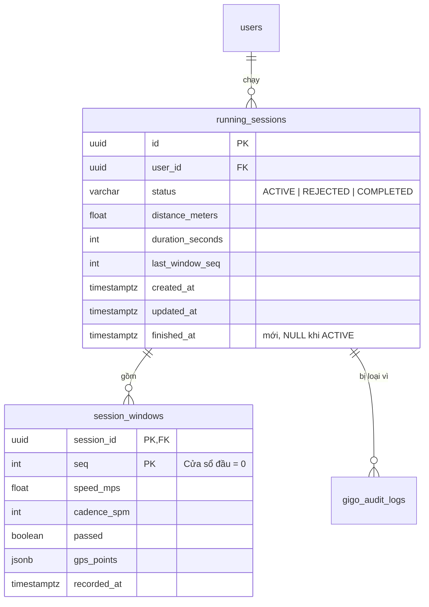
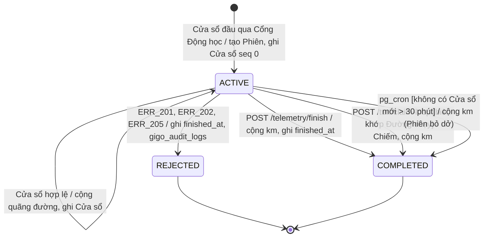
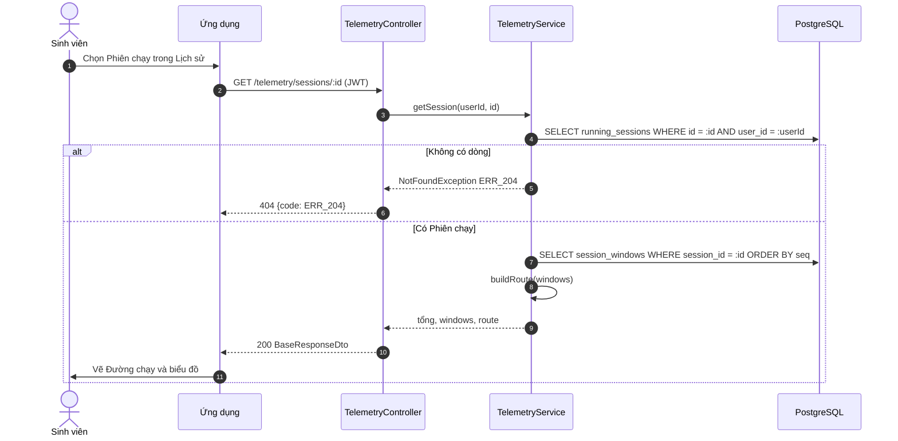

# Bản nháp báo cáo: Đường chạy, Lịch sử Phiên chạy và Phiên bỏ dở

- **Mục báo cáo:** 3.3 (UC đề xuất), 3.5 (chức năng ngầm), 4.3 (ERD & Data Dictionary), 4.4.2 (Telemetry & Anti-GIGO), 4.4.3 (Cổng Hình học)
- **Người phụ trách:** `[CHỜ SỐ LIỆU: phân công DEV 1 / DEV 2]`
- **Trạng thái:** backend đã cài đặt và có test tự động; client (màn Lịch sử, Tổng kết, gửi `gpsPoints`) chưa cài đặt.
- **Nguồn đã đối chiếu:** `GLOSSARY.md`; `backend/src/database/init_schema.sql` (mục 5, 5b, 9); `backend/src/database/season_automation.sql`; `backend/src/modules/telemetry/{telemetry.service.ts, telemetry.controller.ts, session-route.ts, dto/telemetry-payload.dto.ts, dto/session-history.dto.ts}`; `backend/src/modules/turf/turf.service.ts`; `docs/adr/0001-luu-duong-chay-jsonb-theo-cua-so.md`.

> **Lưu ý lệch:** Đường chạy, Tạm dừng, Lịch sử Phiên chạy và Phiên bỏ dở chưa có trong `docs/SRS_SISO_DA_CHIEN_BINH_THANH.md` và `docs/SISO_Timeline_v3.md` (Timeline chỉ có UC-01..UC-08). Tài liệu này đề xuất **UC-09, UC-10** và mã lỗi **ERR_206, ERR_305**; nhóm cần chốt số trước khi đưa vào bản nộp.

---

## 3.3.9. Đặc tả Use Case UC-09 (đề xuất): Xem Lịch sử Phiên chạy

| Mục | Nội dung |
|---|---|
| **Mã** | UC-09 (đề xuất) |
| **Tên** | Xem Lịch sử Phiên chạy |
| **Tác nhân chính** | Sinh viên |
| **Tác nhân phụ** | Không |
| **Mô tả** | Sinh viên xem danh sách các Phiên chạy của chính mình, mới nhất trước, kể cả Phiên bị loại và Phiên đang chạy. |
| **Yêu cầu liên quan** | `[CHỜ SỐ LIỆU: FR mới]`, Cổng Danh tính (JWT) |
| **Tiền điều kiện** | Sinh viên đã đăng nhập (UC-01). |
| **Hậu điều kiện (thành công)** | Ứng dụng hiển thị tối đa 20 Phiên chạy mỗi trang. |
| **Hậu điều kiện (thất bại)** | Không thay đổi dữ liệu. |

**Luồng chính**
1. Sinh viên mở màn Lịch sử.
2. Ứng dụng gọi `GET /api/v1/telemetry/sessions?page=1&limit=20`.
3. Server lọc `running_sessions` theo `user_id` của JWT, sắp `created_at` giảm dần, trả `sessionId`, `status`, `sessionType`, `distanceMeters`, `durationSeconds`, `hexCount`, `rejectionReason`, `startedAt`, `finishedAt`.
4. Ứng dụng hiển thị danh sách; tốc độ trung bình (pace) và năng lượng tiêu hao (ước tính 60 kg) do ứng dụng tự tính.

**Luồng thay thế**
- **A1. (Sinh viên cuộn hết trang, rẽ từ bước 4):** ứng dụng gọi trang kế tiếp; trang trả ít hơn `limit` dòng là trang cuối.

**Ngoại lệ**
- HTTP 400: `page < 1` hoặc `limit` ngoài [1, 50].
- HTTP 401: thiếu hoặc sai JWT.

## 3.3.10. Đặc tả Use Case UC-10 (đề xuất): Xem chi tiết Phiên chạy

| Mục | Nội dung |
|---|---|
| **Mã** | UC-10 (đề xuất) |
| **Tên** | Xem chi tiết Phiên chạy |
| **Tác nhân chính** | Sinh viên |
| **Tác nhân phụ** | Không |
| **Mô tả** | Sinh viên xem Đường chạy trên bản đồ và biểu đồ tốc độ / Nhịp bước theo từng Cửa sổ của một Phiên chạy. |
| **Yêu cầu liên quan** | `[CHỜ SỐ LIỆU: FR mới]` |
| **Tiền điều kiện** | Sinh viên đã đăng nhập; Phiên chạy thuộc về Sinh viên đó. |
| **Hậu điều kiện (thành công)** | Ứng dụng vẽ Đường chạy (mỗi đoạn một đường, không nối qua chỗ Tạm dừng) và biểu đồ. |
| **Hậu điều kiện (thất bại)** | Không thay đổi dữ liệu. |

**Luồng chính**
1. Sinh viên chọn một Phiên chạy trong Lịch sử (UC-09) hoặc kết thúc Phiên chạy.
2. Ứng dụng gọi `GET /api/v1/telemetry/sessions/:id`.
3. Server đọc Phiên chạy theo `id` và `user_id`, đọc các Cửa sổ trong `session_windows` theo `seq`.
4. Server ghép Đường chạy (`buildRoute`): bỏ điểm sai số âm hoặc > 20 m, tách đoạn khi hai điểm cách nhau > 15 s, bỏ đoạn chỉ có một điểm; trả GeoJSON `MultiLineString`.
5. Ứng dụng vẽ Đường chạy, biểu đồ và "x/y Cửa sổ hợp lệ" (đếm `passed`).

**Ngoại lệ**
- `ERR_204` (`SESSION_NOT_FOUND`): Phiên chạy không tồn tại hoặc của Sinh viên khác → HTTP 404 (không phân biệt hai trường hợp để không lộ Phiên của người khác).
- HTTP 400: `id` không phải UUID.

---

## 3.5. Chức năng ngầm bổ sung

| Mã | Tên | Vị trí chạy | Kích hoạt khi | Đầu vào | Xử lý | Đầu ra | Yêu cầu liên quan |
|---|---|---|---|---|---|---|---|
| `[CHỜ SỐ LIỆU]` | Ghi Cửa sổ | `TelemetryService.verifyWindow` | Mỗi Cửa sổ qua Cổng Động học | 256 mẫu gia tốc, `gpsPoints` | Kiểm thời gian điểm GPS (lệch ≤ 1 s ngoài khoảng mẫu); bỏ điểm sai số ngoài 0–20 m hoặc cách điểm neo nhanh hơn 9 m/s; ghi một dòng `session_windows` cùng transaction với cộng quãng đường | Dòng `session_windows` | UC-03, UC-04 |
| `[CHỜ SỐ LIỆU]` | Đóng Phiên bỏ dở | pg_cron `siso_finish_stale_sessions`, mỗi 5 phút | Phiên `ACTIVE` không có Cửa sổ mới > 30 phút | `running_sessions` | Chuyển `COMPLETED`, ghi `finished_at`, cộng Km cá nhân và Quỹ Km; `FOR UPDATE SKIP LOCKED` | Số Phiên đã đóng (jsonb) | UC-06, UC-08 |
| `[CHỜ SỐ LIỆU]` | Đối chiếu Vòng khép với Đường chạy | `TurfService.claimLoop` (Cổng Hình học) | Gọi `POST /api/v1/turf/claim-loop` | `boundaryH3Indexes`, `session_windows.gps_points` | Mỗi Ô đất biên phải nằm trong 1 vòng ô quanh một điểm GPS có sai số 0–20 m | Cho phép Chiếm hoặc `ERR_305` | UC-05 |

---

## 4.3. ERD (phần thay đổi) & Data Dictionary

*Hình 4.3-x. ERD phần Đường chạy (chỉ các cột liên quan của `running_sessions`).*

Mỗi Phiên chạy có nhiều Cửa sổ; khoá chính ghép `(session_id, seq)` chặn ghi trùng một Cửa sổ. Xoá Phiên chạy thì xoá các Cửa sổ của nó (`ON DELETE CASCADE`). Đường chạy lưu dạng JSONB trong từng Cửa sổ thay vì bảng điểm riêng hay cột PostGIS, vì không có truy vấn không gian nào chạy trong CSDL (ADR-0001).

**Bảng `session_windows`** – Cửa sổ của Phiên chạy (Đường chạy + tốc độ / Nhịp bước)

| Cột | Kiểu | Ràng buộc | Mặc định | Mô tả |
|---|---|---|---|---|
| `session_id` | `UUID` | PK, FK → `running_sessions(id)` `ON DELETE CASCADE`, NOT NULL | | Phiên chạy chứa Cửa sổ |
| `seq` | `INT` | PK, NOT NULL, `CHECK (seq >= 0)` | | Thứ tự Cửa sổ; Cửa sổ đầu = 0, sau đó là `seq` client đã ký |
| `speed_mps` | `FLOAT` | NOT NULL, `CHECK (speed_mps >= 0)` | | Vận tốc trung bình trong Cửa sổ (m/s) |
| `cadence_spm` | `INT` | NOT NULL | `0` | Nhịp bước Cổng Sinh trắc đo được (bước/phút) |
| `passed` | `BOOLEAN` | NOT NULL | | `false` = Cửa sổ chỉ bị cảnh báo ở Cổng Sinh trắc |
| `gps_points` | `JSONB` | NOT NULL | `'[]'` | Mảng `{lat, lng, timestamp, accuracy}` (timestamp epoch ms, accuracy m) |
| `recorded_at` | `TIMESTAMPTZ` | NOT NULL | | Thời điểm mẫu gia tốc đầu tiên của Cửa sổ |

Chỉ mục: khoá chính (`session_id`, `seq`) – đọc Cửa sổ của một Phiên chạy theo thứ tự. RLS bật, **không có policy**: chỉ backend đọc được, vì Đường chạy lộ nơi ở của Sinh viên.

**Bảng `running_sessions`** – cột mới

| Cột | Kiểu | Ràng buộc | Mặc định | Mô tả |
|---|---|---|---|---|
| `finished_at` | `TIMESTAMPTZ` | NULL | `NULL` | Thời điểm Phiên chạy kết thúc (`COMPLETED` hoặc `REJECTED`); ghi ở `finishSession`, `claimLoop`, `rejectSession` và `private.finish_stale_sessions` |

---

## 4.4.2. Vòng đời Phiên chạy (cập nhật)

*Hình 4.4.2-x. Lược đồ Trạng thái Phiên chạy (`running_sessions.status`).*

Tạm dừng không phải trạng thái riêng: Phiên vẫn `ACTIVE`, chỉ là ứng dụng ngừng gửi Cửa sổ, nên `duration_seconds` (tổng thời lượng các Cửa sổ) là thời gian di chuyển. ERR_203 và ERR_206 chỉ bỏ Cửa sổ, không đổi trạng thái. Tạm dừng quá 30 phút thì Phiên thành Phiên bỏ dở và được đóng; ứng dụng gửi tiếp sẽ nhận `ERR_204` và phải mở Phiên mới.

## 4.4.2. Lược đồ Tuần tự: Xem chi tiết Phiên chạy (UC-10)

*Hình 4.4.2-y. Lược đồ Tuần tự Xem chi tiết Phiên chạy.*

---

## Bảng mã lỗi (bổ sung vào SRS mục 15)

| Mã | Tên | Điều kiện | Phản hồi |
|---|---|---|---|
| `ERR_204` | `SESSION_NOT_FOUND` | Phiên chạy không tồn tại, của Sinh viên khác hoặc đã kết thúc | HTTP 404 |
| `ERR_206` | `INVALID_GPS_POINTS` | Điểm GPS trong Cửa sổ lệch quá 1 s ngoài khoảng thời gian 256 mẫu gia tốc | HTTP 400; chỉ bỏ Cửa sổ đó, Phiên chạy tiếp tục |
| `ERR_305` | `ROUTE_MISMATCH` | Có Ô đất biên của Vòng khép không nằm trong 1 vòng ô quanh Đường chạy thật | HTTP 400; không Chiếm, không cộng km, Phiên vẫn `ACTIVE` |

---

## Việc còn lại cho báo cáo

- Nhóm chốt số UC-09, UC-10 và FR tương ứng; thêm vào Use Case tổng thể (3.2) và Timeline.
- Thêm `session_windows`, `finished_at` vào ERD đầy đủ ở 4.3 (ERD SRS còn thiếu cả `status`, `gigo_audit_logs`, xem điểm lệch #6 của skill).
- Test case 5.2 cho UC-09/UC-10 (ca đúng + ca ERR_204) và ERR_305: `[CHỜ SỐ LIỆU: kết quả chạy trên thiết bị thật]`.
- Ngưỡng 15 s tách đoạn và 1 vòng ô nới sai số là **ngưỡng tạm**, cần hiệu chỉnh bằng dữ liệu thực địa.
